# Coupled simulator for research on driver-pedestrian interactions made in Unity

The coupled simulator lets several people take part in the same traffic scene at the same time: one or more drivers of manual cars, passengers of automated vehicles (AVs) who control an external human-machine interface (eHMI), and pedestrians who walk with a keyboard or a motion suit, on flat screens or in head-mounted displays. AI-controlled cars and pedestrians fill the scene. Everything that happens is logged for analysis.

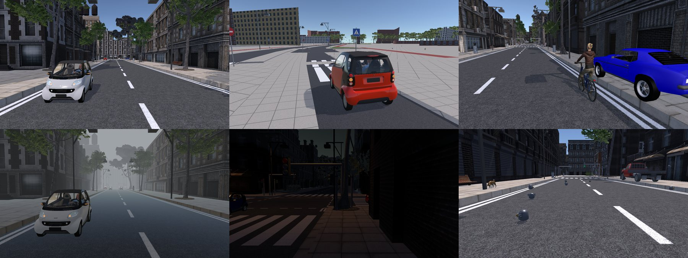

The simulator is open source and free to use. It is aimed at, but not limited to, academic research. Forks, pull requests and other contributions in the spirit of open science are welcome 😍. For enquiries about collaboration, contact p.bazilinskyy@tue.nl.

📺 Demo of the simulator with 3 agents:

[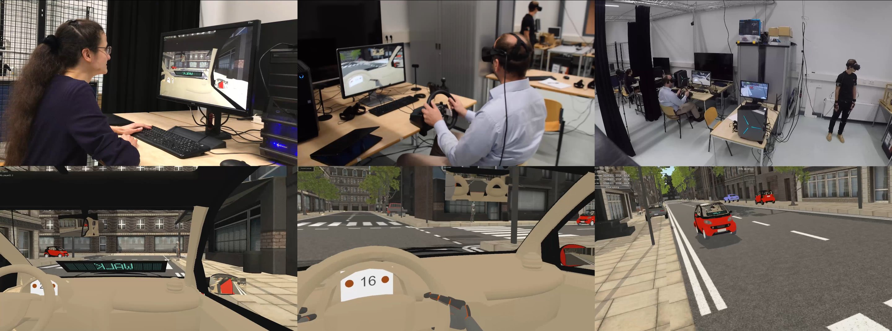](https://www.youtube.com/watch?v=W2VWLYnTYrM)

## Contents
- [Citation](#citation) · [Examples of use](#examples-of-use) · [License](#license)
- [Features](#features) · [Graphics](#graphics)
- [Getting started, step by step](#getting-started-step-by-step) (for first-time users) · [Installation](#installation)
- [Running the simulator](#running-the-simulator): [host](#running-as-a-host), [client](#running-as-a-client), [several agents on one machine](#several-agents-on-one-machine), [builds and command line](#builds-and-command-line-options), [automatic trials](#running-trials-automatically), [trial files and counterbalancing](#trial-files-and-counterbalancing), [recording videos](#recording-trial-videos), [dashboard](#experimenter-dashboard)
- [Controls](#controls)
- [Environment and vehicles](#environment-and-vehicles): [city maps](#city-maps-openstreetmap), [traffic signs](#traffic-signs), [vehicles](#vehicles)
- [Networking](#networking)
- [Data logging](#data-logging), [road network export](#exporting-the-road-network)
- [Configuration](#configuration): [experiments](#experiment-definitions), [new experiments](#setting-up-a-new-experiment), [agents](#configuration-of-agents), [waypoints](#configuration-of-waypoints), [AI pedestrians](#ai-pedestrians), [AI cars](#ai-cars), [cyclists and riders](#cyclists-e-scooter-and-moped-riders), [automated driving and take-over](#automated-driving-and-take-over-requests), [scripted paths](#scripted-paths), [background traffic](#configuration-of-background-traffic), [SUMO](#traffic-from-sumo), [animals](#animals), [time of day and weather](#time-of-day-and-weather), [eye contact](#configuration-of-drivers-eye-contact), [daylight](#configuration-of-daylight-conditions), [traffic lights](#configuration-of-traffic-lights), [eHMIs](#configuration-of-ehmis), [auditory eHMIs](#auditory-ehmis), [car prefabs](#details-on-editing-car-prefabs)
- [Testing](#testing)
- [Hardware](#hardware): [monitors](#several-monitors-and-mirrors), [headsets](#head-mounted-displays-vr), [wheels](#steering-wheels-pedals-and-gamepads), [motion suit](#xsens-mvn-motion-suit), [network](#network)
- [FAQ](#faq)
- [Used assets](#used-assets)

**Note on the git history (November 2026):** the history was rewritten to keep only files that the simulator still uses, which cut a clone from 5.2 GB to 0.7 GB. Clones and forks made before then cannot be merged with the new history: clone the repository again. Older study branches and the full earlier history are kept in an archive repository; ask the maintainer for access.

## Citation
If you use the coupled simulator for academic work, please cite:

> Bazilinskyy, P., Kooijman, L., Dodou, D., & De Winter, J. C. F. (2020). Coupled simulator for research on the interaction between pedestrians and (automated) vehicles. 19th Driving Simulation Conference (DSC). Antibes, France.

## Examples of use
1. Get out of the way! Examining eHMIs in critical driver-pedestrian encounters in a coupled simulator - [repo](https://github.com/bazilinskyy/coupled-sim-evasive), [paper](https://doi.org/10.1145/3543174.3546849).
1. Stopping by looking: A driver-pedestrian interaction study in a coupled simulator using head-mounted displays with eye-tracking - [paper](http://doi.org/10.1016/j.apergo.2022.103825).

## License
The source code of the coupled simulator is released under the [MIT License](LICENSE). Third-party assets included in this repository (see [Used assets](#used-assets)) are not covered by this license. They remain under the license of their developers, such as the Unity Asset Store EULA, MIT or CC0.

## Features
- Up to **4 human participants** in one scene (a host and three clients) over a local network.
- Roles: driver of a manual car, passenger of an AV (controls its eHMI), pedestrian, cyclist, e-scooter rider, moped rider.
- Input: keyboard, gamepads and steering wheels with pedals (Logitech, Thrustmaster, Fanatec, Moza; profiles and in-simulator calibration; force feedback on Logitech wheels), Xsens MVN motion suit for pedestrians.
- Output: flat screens (also several monitors side by side, and mirror views) or head-mounted displays through OpenXR (Meta Quest, Varjo, HTC Vive, Valve Index, HP Reverb, Pico), with eye-tracking logs on headsets that have eye tracking.
- AI cars that follow waypoint paths with configurable speed, acceleration, yielding, blinkers and driver eye contact.
- Realistic car physics: engine and automatic gearbox, brakes with ABS, tyre grip that drops in the rain, suspension and anti-roll bars, matched to the real cars.
- Background traffic with a choice of car-following models (IDM, Gipps, Krauss) that follows other cars, stops at red lights, slows down for bends and yields to pedestrians.
- Participants can also be cyclists, e-scooter riders or moped riders, with two-wheeler dynamics (power, legal speed limits, lean and steering).
- Animals moving around the world (pigeons, dogs, cats, foxes, deer, horses) that wander, eat and flee from traffic and people; traffic stops for them.
- Time of day (solar position) and weather (clouds, rain with wet roads, fog), set per trial; URP graphics with post-processing and ambient occlusion.
- 20 city maps from OpenStreetMap on six continents (Eindhoven, Delft, London, Tokyo, New York, Cairo, São Paulo, Sydney, ...), built at load time, and maps of any place by coordinates.
- Coupling with [SUMO](https://eclipse.dev/sumo/) over TraCI: SUMO traffic in the scene, participants' cars and the AV in SUMO.
- AI pedestrians with individual walking speeds, gap-acceptance crossing decisions that react to yielding cars and eHMIs, collision avoidance (social force model), traffic-aware head movements, and 12 realistic avatars.
- eHMIs on the hood, roof and windshield of AVs, switched by the passenger or the host; auditory eHMIs (cues on eHMI states and on yielding, stopping, driving off) and AVAS sounds.
- Automated driving with take-over requests (visual and auditory warning, reaction times logged) and hand-back to the automation; AVs that follow waypoints, a car-following model or a path file (speed profiles, recorded trajectories).
- Traffic lights with programmable sequences; traffic signs (stop, give way, speed limits, crossings, one way, ...), placed from OpenStreetMap on city maps; day and night versions of the town.
- Logging of all agents (cars, pedestrian skeletons, traffic lights, eye contact) to binary files, conversion to CSV, and live streaming over UDP; export of the road network (GeoJSON, OBJ) for analysis.
- Automatic trial sequences with per-trial parameters and video recording; trial files (CSV/JSON) with counterbalancing per participant (balanced Latin square).
- An experiment setup window: new experiments from templates on any map, a check of the whole set-up before Play.
- A web dashboard for the experimenter: run the session, switch eHMIs, weather and time from any device, and watch a live map of all agents.

## Graphics
The simulator uses the **Universal Render Pipeline** (URP 17.6): the pipeline asset is `Assets/URPDefaultResources/Fantastic.asset` (HDR, 4× MSAA, soft shadows up to 150 m, forward rendering; the 24 street lamps nearest to the viewer are lit) with its renderer `Default_Forward_Renderer` (screen-space ambient occlusion). Post-processing (ACES tonemapping, bloom, colour grading, vignette) comes from the global volume `Post-processing (URP)` in the environment scenes with `Assets/Settings/Rendering/SimulatorVolumeProfile.asset`; every participant camera gets post-processing and SMAA anti-aliasing when it starts rendering (`UrpCameraSetup`). Materials were converted with the Render Pipeline Converter; `Assets/Editor/Graphics/GraphicsSetup.cs` holds the conversion steps (including baking the Tree Creator trees to normal meshes).

**Quality levels** for slower PCs and VR (`-quality <name>` on the command line, or `Edit` ➡️ `Project Settings` ➡️ `Quality`):

| Level | Shadows | Anti-aliasing | Ambient occlusion | Render scale | 1080p view on an Intel UHD 630 |
| --- | --- | --- | --- | --- | --- |
| `Fantastic` (default) | 4 cascades to 150 m, 4096, soft | MSAA 4× | yes | 1 | about 100 ms |
| `Balanced` | 2 cascades to 100 m, 2048, soft | MSAA 2× | yes | 1 | about 70 ms |
| `Performance` | 1 cascade to 60 m, 1024, hard | none | no | 0.8 | about 47 ms |

Shadows cost most (about 40% of the frame on that GPU). In the town, the trees have mesh LODs, flat surfaces cast no shadows, and occlusion culling is baked (`Coupled Sim` ➡️ `Graphics` ➡️ `Optimise scenes` redoes this after changing the scenes); the smoke test measures the render time of the participant's view (`-smokeBench` also measures the cost of each feature).

## Getting started, step by step
This part is for anyone who has never used Unity or GitHub. Follow the steps in order; each takes a few minutes, except the first opening of the project (step 4), which takes up to an hour. Words in **bold** are the names of buttons or windows you will see on the screen.

### Words you will meet
| Word | What it means here |
| --- | --- |
| **Unity** | The program the simulator is made with. You open the simulator in it, like you open a document in Word. |
| **Unity Hub** | A small program that installs Unity and opens Unity projects. |
| **Project** | The simulator's folder. Unity calls a folder like this a project. |
| **Scene** | One "world" of the simulator: the start screen (`StartScene`), the town (`MainScene`), a city map (`OsmMap`). |
| **Play / Play mode** | The ▶ button at the top of Unity starts the simulator inside Unity; pressing it again stops it. |
| **Host** and **client** | Every computer taking part is an *agent*. One of them is the **host**: it chooses the experiment and starts it. The others are **clients**: they connect to the host. Alone, you are the host. |
| **Role** | Who a participant is in the scene: driver, passenger of an automated car (AV), pedestrian, cyclist, e-scooter or moped rider. |
| **Experiment** | A ready-made situation: a world, the roles in it, the AI cars and pedestrians, the weather. |
| **Trial** | One run of an experiment with one participant. A session is usually several trials. |
| **Inspector** | The window on the right of Unity that shows the settings of whatever you clicked. |
| **Prefab** | A saved, reusable object (a car, a pedestrian, a whole experiment). Changing the prefab changes every copy of it. |
| **Spawn point** | The place where a participant starts in the world. |

### 1. What you need
- A computer with **Windows 10 or 11** (or a Mac, for trying things out: steering wheels, headsets and the motion suit only work on Windows).
- About **30 GB of free disk space** (Unity takes about 10 GB, the simulator about 15 GB once opened).
- An internet connection and a free **Unity account** (make one at [unity.com](https://unity.com) with your university e-mail; the free "Personal" license is enough).
- For a good frame rate: a graphics card such as an NVIDIA GeForce RTX 3060 or better. On a laptop or office PC the simulator also runs, but slower (see [Graphics](#graphics) for the faster quality levels).

### 2. Install Unity Hub and Unity
1. Download **Unity Hub** from [unity.com/download](https://unity.com/download) and install it like any other program.
2. Open Unity Hub and **Sign in** with your Unity account. If it asks for a license, choose the free **Personal** license.
3. You do not have to install Unity itself yet: in step 4, Unity Hub notices which version the simulator needs (**6000.6.9f1**, also called Unity 6.6) and offers to install it. When it asks which **modules** to add, you need none to use the simulator inside Unity. Tick **Windows Build Support (Mono)** only if you want to make a stand-alone program for the lab PCs from a Mac (on Windows it is included); you do not need IL2CPP, Android, iOS or WebGL. Windows may ask for administrator permission while installing: that is normal.

Use exactly version 6000.6.9f1. A newer Unity may change or break the project; an older one cannot open it.

### 3. Download the simulator
The easiest way, without typing commands:
1. Install **GitHub Desktop** from [desktop.github.com](https://desktop.github.com) (you can skip signing in to GitHub).
2. In GitHub Desktop choose **File** ➡️ **Clone repository** ➡️ the **URL** tab, and paste `https://github.com/bazilinskyy/coupled-sim`.
3. Under **Local path** choose a short folder path **without spaces**, for example `C:\Unity\coupled-sim` (long paths cause errors on Windows). Press **Clone** and wait until it finishes (about 0.7 GB).

Later, to get the newest version, open GitHub Desktop and press **Fetch origin** and then **Pull origin**. If GitHub Desktop says you have local changes (Unity changes a few files by itself), choose **Stash changes and continue**; your own experiments are best kept in new files (step 9), so nothing of yours is lost.

(If you know git: `git clone https://github.com/bazilinskyy/coupled-sim.git` does the same. Downloading the ZIP file from GitHub also works, but then you cannot update it easily.)

### 4. Open the project in Unity
1. In Unity Hub, go to **Projects** and press **Add** ➡️ **Add project from disk**. Select the `coupled-sim` folder you just downloaded (the folder that contains `Assets`), and confirm.
2. The project appears in the list. If Unity Hub shows a warning that the editor version is missing, press **Install** (this is the step-2 install of Unity 6000.6.9f1; it takes 10-30 minutes).
3. Click the project to open it. **The first time takes long** (20-60 minutes): Unity prepares all the files. A small window shows "Importing" or "Compiling" with a progress bar that sometimes stands still for minutes; that is normal, do not close Unity. Wait until the Unity window appears and the progress bar at the bottom right is gone.
4. If Unity asks whether to open in **Safe Mode**, choose **Ignore** (this happens when something did not finish preparing; see [When something goes wrong](#11-when-something-goes-wrong)).

### 5. The Unity window
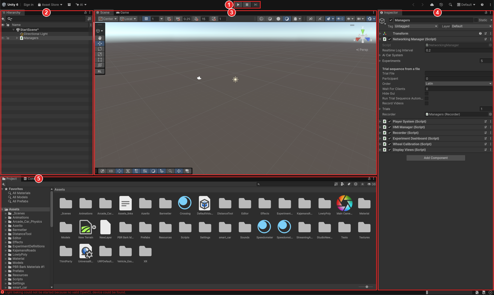

1. **Play** ▶: starts and stops the simulator. While it runs, the button is blue.
2. **Hierarchy**: what is in the open scene. In `StartScene` there is an object called `Managers` that holds the simulator's settings.
3. **Scene** and **Game**: the **Game** tab shows what a participant sees when you press Play.
4. **Inspector**: the settings of what you clicked (here `Managers`).
5. **Project** and **Console**: the **Project** tab shows the files of the simulator; the **Console** tab shows messages. Red messages are errors (one red line about "light baking" or "OpenCL" can be ignored).

The **Coupled Sim** menu (in the menu bar at the very top of the screen on a Mac, or at the top of the Unity window on Windows) has the simulator's own tools: setting up experiments, checking them, building, and more.

**Open the start scene first.** In the **Project** tab open the folder `Assets` ➡️ `_Scenes` and double-click **StartScene**. The **Hierarchy** then shows `StartScene` with `Managers` in it. The simulator always starts from this scene: if another scene of the simulator (the town, a city map) is open when you press **Play**, Unity starts from `StartScene` anyway, but the settings you change in the **Inspector** (step 10) are those of `StartScene`, so keep it open.

**Closing Unity:** **File** ➡️ **Quit** (on a Mac **Unity** ➡️ **Quit**). If Unity asks whether to save changes to a scene you did not mean to change, choose **Don't Save**.

### 6. Your first drive (alone, on one computer)
1. Press **Play** ▶. The **Game** tab shows three buttons:

   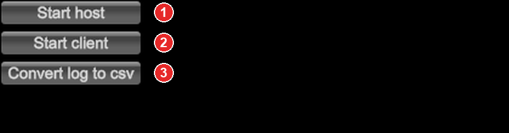

   **1** Start host (you run the experiment), **2** Start client (you join someone else's experiment), **3** Convert log to csv (turn recorded data into a spreadsheet file, see step 7).
2. Press **Start host**. You now see the host's choices:

   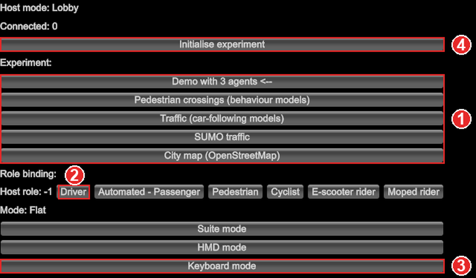

   1. **Experiment**: click the experiment. **Demo with 3 agents** is a good first one (the arrow `<--` shows which one is selected).
   2. **Role binding**: click the role you want to play, for example **Driver**. "Host role" then shows the role's number instead of -1 (the roles are counted from 0, so Driver, the first one, is 0).
   3. **Mode**: click **Keyboard mode** to play on the screen with keyboard and mouse (**HMD mode** is for a VR headset, **Suite mode** for the Xsens motion suit).
   4. Press **Initialise experiment** (the top button in the picture).
3. Wait until the world has loaded (up to a minute). The screen then shows who is ready and a **Start simulation** button:

   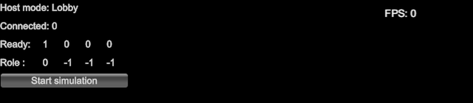

   **Ready: 1** means your computer is ready; the other columns are for other computers (clients) and stay 0 when no client is connected, which is fine. Press **Start simulation**.
4. Drive! First **click once in the Game view**, so the keys go to the simulator:

   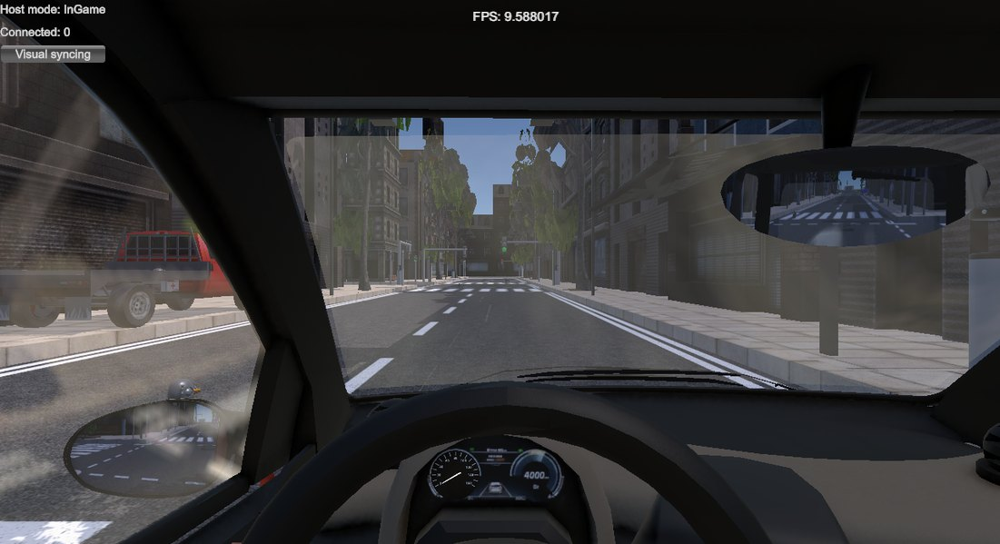

   - `W` / `S` (or the arrow keys): accelerate / brake; `A` / `D`: steer; `Space`: brake; `R` then `W`: reverse (only when the car stands still); `F`: forward again; `Q` / `E`: blinkers; `Esc`: end the drive.
   - As a pedestrian: `W` `A` `S` `D` to walk, `Shift` to run, hold the right mouse button and move the mouse to look around.
   - All keys are listed under [Controls](#controls). The buttons and numbers in the corner are for the experimenter: **Visual syncing** flashes the screen to line up video recordings with the data, and the frame rate (FPS) shows how smoothly the simulator runs (60 or more is good). `Tab` hides them; press `Tab` again to show them.
5. To stop, press **Play** ▶ again. Everything you changed while playing is undone; the data that was recorded stays (step 7).

### 7. Where your data are
Every run writes its data into the folder **`ExperimentLogs`** inside the `coupled-sim` folder, next to the `Assets` folder. To open it from Unity: in the **Project** tab right-click the `Assets` folder and choose **Show in Explorer** (Windows) or **Reveal in Finder** (Mac); this opens the `coupled-sim` folder, where you see `ExperimentLogs`. The folder only appears after your first run. The files are named after the role and the date and time, for example `HostLog-Driver-2026_11_13_14_05_22.binLog`; some experiments write extra `.csv` files next to it.

`.binLog` files are compact but cannot be opened in Excel. To turn one into a spreadsheet file:
1. Press **Play**, and on the start screen press **Convert log to csv** (3).
2. Click the file you want (the newest is at the top). Ignore **Custom reference points** (they are for measuring from a chosen point, such as a crossing) and, under **Stored reference Point**, press **Transform with World Root**.
3. A line "Saved ..." shows where the new file `World Root-HostLog-....csv` is (in `ExperimentLogs`). Open it in Excel, R or Python.

In Excel, open it with **Data** ➡️ **From Text/CSV** and choose **Semicolon** as the delimiter. The numbers use a decimal point; if Excel shows them as dates or text (computers set to Dutch or German use a decimal comma), choose **Transform Data**, then **Use Locale** "English (United States)" for the number columns.

To watch a run again, press **Replay a recording** on the start screen instead (see [Data logging](#data-logging)).

What is in these files, and the other files there (pedestrian decisions, eye gaze, take-over times, animals), is described under [Data logging](#data-logging).

### 8. With several participants (several computers)
1. Install the simulator on every computer as above, **the same version on all** (in GitHub Desktop: Fetch and Pull on each).
2. Connect all computers to the same network (the same lab switch or Wi-Fi). The first time you press **Start host** or **Start client**, Windows asks whether to allow Unity on the network: tick **Private networks** (and **Domain networks** on university PCs) and press **Allow access**. See [Network](#network) if the computers cannot find each other.
3. On the host computer: press **Play** and **Start host**. The **Console** shows a line `Listening on ...` with the host's address (four numbers with dots, for example `192.168.1.20` or `10.0.0.5`).
4. On each other computer: press **Play** and **Start client**. The address box already holds `192.168.1.11`: replace it with the host's address. The **Connect** button appears only when the address is complete (four numbers); press it, then choose the mode (for example **Keyboard mode**).
5. On the host, the clients appear ("Connected: 1", ...). Choose the experiment, give each participant a role under **Role binding** (one row per computer), press **Initialise experiment**, wait until every column under **Ready** shows 1, and press **Start simulation**.

The experimenter can also do all of this from a phone or tablet in the same network with the [dashboard](#experimenter-dashboard).

### 9. Making your own experiment
Open **Coupled Sim** ➡️ **Experiments** ➡️ **Setup…**. The window has three tabs.

**New experiment**: give it a name, pick a **Template** (start from **Base** for the town, or **CityMap** for a real city), choose **Where** it takes place (the town, one of 20 cities, or any place by coordinates), untick roles you do not need, choose traffic, animals, time of day and weather, and press **Create and register**. Then place the spawn points:
1. Press **Open it to place spawn points**. Unity opens the experiment's world with a copy of your experiment in it (for city maps, the experiment itself opens).
2. In the **Hierarchy**, unfold the experiment and click a spawn point; move it with the arrows in the **Scene** view.
3. When all are in place, click the experiment at the top of the **Hierarchy**, and in the **Inspector** choose **Overrides** ➡️ **Apply All**. This saves the positions into the experiment.
4. Delete the copy from the **Hierarchy** (right-click ➡️ **Delete**), save the scene (`Ctrl+S`, on a Mac `Cmd+S`), and open **StartScene** again (step 5).

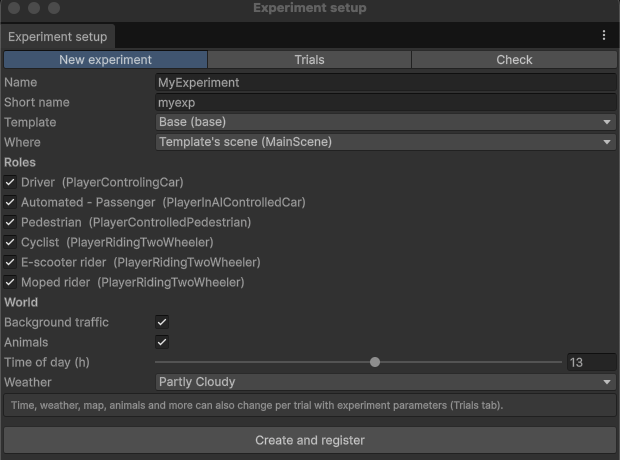

**Trials**: plan a session in a spreadsheet instead of clicking through it (step 10). Choose a trial file and a participant number and press **Preview** to see that participant's order:

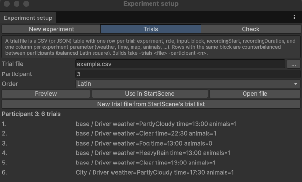

**Check**: press **Check experiments and trials** to find mistakes before you run anything. Errors (red) must be fixed; warnings (yellow), such as older experiments that are not registered, can be ignored. The same check runs every time you press Play.

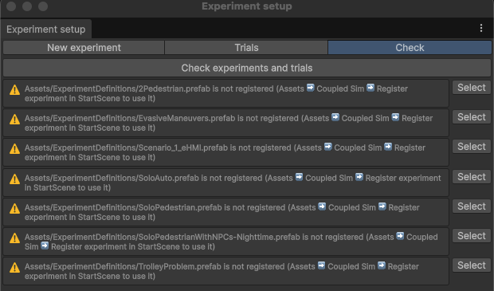

More detail: [Setting up a new experiment](#setting-up-a-new-experiment).

### 10. Running a whole session automatically
For a real study you usually want each participant to get a fixed list of trials, in a counterbalanced order, without clicking:
1. Make a trial file: in the **Project** tab open `Assets/StreamingAssets/Trials`, click `example.csv`, press `Ctrl+D` (Mac `Cmd+D`) to copy it, and give the copy a new name. Open it in Excel (or double-click it in Unity). Each row is one trial: the experiment, the role, the conditions (weather, time, ...), and a `block` letter for the conditions whose order should change between participants. Keep the lines that start with `#` (they hold settings). Save it as CSV.
2. **With Play off**, click `Managers` in the **Hierarchy**. In the **Inspector**, under **Networking Manager**: type the file name in **Trial File** (or press **Use in StartScene** in the **Trials** tab of step 9), the participant's number in **Participant**, and tick **Run Trial Sequence Automatically** (and **Hide Gui**, so the participant does not see the buttons). Save the scene (`Ctrl+S` / `Cmd+S`); changes made while playing are lost.

   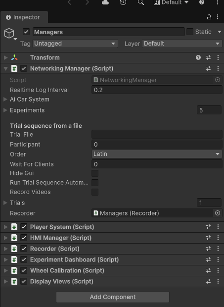

3. Press **Play**: the first trial starts by itself. **Esc** ends a trial and starts the next one; after the last trial the simulator stops.
4. For the next participant, change **Participant** (Play off) and save. To go back to choosing by hand (step 6), untick **Run Trial Sequence Automatically** and **Hide Gui**.

The log files of that session start with the participant and trial number (for example `HostLog-P03-T02-...`), and `ExperimentLogs/Session-P03-....csv` lists the order this participant got. Details: [Trial files and counterbalancing](#trial-files-and-counterbalancing).

### 11. When something goes wrong
| What you see | What to do |
| --- | --- |
| Unity Hub says the editor version is not installed | Press **Install** next to the project (step 4). Use 6000.6.9f1, not another version. |
| Unity asks about **Safe Mode** when opening | Choose **Ignore**. If red errors stay in the **Console**, close Unity, delete the `Library` folder inside `coupled-sim`, and open the project again (Unity rebuilds it). |
| Pressing **Play** shows a dialog **Experiment setup problems** | The check (step 9) found a mistake. Read it, fix it, or press **Play anyway** if you are only trying things out. |
| Pressing **Play** shows no buttons | Open **StartScene** (step 5). If it is open, press `Tab` (it hides and shows the buttons) and check that **Hide Gui** on `Managers` is unticked. |
| **Convert log to csv** shows no files | Nothing has been recorded yet: run an experiment first (step 6). |
| Nothing happens when you press keys | Click once inside the **Game** view first. |
| Parts of the world are **pink** | A material was not converted for the current graphics; see the [FAQ](#faq). |
| The simulator is very slow | Close other programs, or use a lower quality level (see [Graphics](#graphics)). In Unity, close the **Scene** tab while playing. |
| Clients cannot connect | Same network? Same simulator version? Firewall allowed? See [Network](#network). |
| The steering wheel does nothing | While playing, press `F2` to open the wheel calibration window and follow it: |

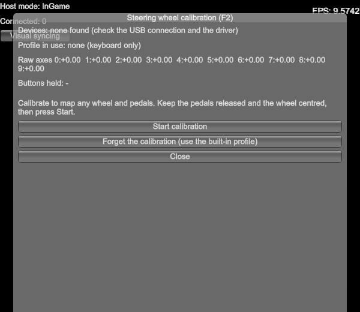

If you are stuck, ask in the lab or open an issue on GitHub with a screenshot of the **Console**.

## Installation
Step by step: see [Getting started](#getting-started-step-by-step). In short: Unity **6000.6.9f1** (Unity 6.6) through Unity Hub, with Windows Build Support to build for the lab PCs; clone `https://github.com/bazilinskyy/coupled-sim.git`; add the folder in Unity Hub. The first import takes 20-60 minutes.

Platforms: the simulator is developed and used on Windows 10 and 11, and also runs on macOS (tested on macOS 15). Input and output devices (steering wheel, motion suit, HMD) are supported on Windows only. Unity stops providing the editor for Intel Macs after Unity 6.7 LTS. The version of the simulator for Unity 2022.3 is in the archive repository (see the note on the git history above).

## Running the simulator
Open `Assets/_Scenes/StartScene.unity`. All settings for a run are on the `Managers` game object, mainly in its `NetworkingManager` and `PlayerSystem` components.


### Running as a host
1. Make sure that `Hide GUI`, `Run Trial Sequence Automatically` and `Record Videos` on `Managers` ➡️ `NetworkingManager` are unchecked.
2. Press Play to enter `Play Mode`.
3. Press `Start host`. The console shows `Listening on <ip address>`: clients connect to this address.
4. Wait for the clients to connect, if any.
5. Select an experiment under `Experiment`.
6. Assign a role to each participant under `Role binding`. A participant without a role runs "headless" (no avatar).
7. Select the display/control mode of the host: `Suite mode`, `HMD mode` or `Keyboard mode`.
8. Press `Initialise experiment`: all agents load the experiment scene.
9. When every agent is ready (the scene is loaded everywhere), press `Start simulation`.

### Running as a client
1. Make sure that `Hide GUI`, `Run Trial Sequence Automatically` and `Record Videos` are unchecked.
2. Press Play to enter `Play Mode`.
3. Press `Start client`, enter the IP address of the host (default 192.168.1.11) and press `Connect`.
4. Select a mode (`Suite mode`, `HMD mode`, `Keyboard mode`).
5. Wait until the host starts the simulation.

### Several agents on one machine
For testing and debugging only:
1. Run the host inside the Unity editor as described above and note the IP address it logs.
2. Build the simulator (`Coupled Sim` ➡️ `Build`) and start one or more builds as clients, connecting to that address (127.0.0.1 also works; `-connect 127.0.0.1` connects at once).

Only the window that has focus receives keyboard input.

### Builds and command-line options
`Coupled Sim` ➡️ `Build` ➡️ `Windows` / `macOS` / `Linux` builds the simulator into `Builds/{platform}` (in batch mode: `-executeMethod BuildTools.Build -buildTarget Win64`); the experiment scenes are added to the build settings first. The first build compiles all shader variants and takes a while (about an hour on a slow PC); later builds reuse them. A build (or the editor in batch mode) takes these options:

| Option | Meaning |
| --- | --- |
| `-host` | start as host (manual mode: roles and start from the GUI or the [dashboard](#experimenter-dashboard)) |
| `-connect <ip>` | start as client and connect to the host at that address |
| `-autoRun` | run the trials automatically (`Run Trial Sequence Automatically`) |
| `-clients <n>` | automatic trials: wait for n clients; they get the roles of the trial parameter `clientRoles` (e.g. `Pedestrian,Cyclist`), else the next free roles |
| `-trials <file>`, `-participant <n>`, `-order latin\|random\|none` | [trial file and counterbalancing](#trial-files-and-counterbalancing) |
| `-quality Fantastic\|Balanced\|Performance` | [graphics quality](#graphics) for slower PCs |
| `-sumoConnect <host:port>` | connect to a running [SUMO](#traffic-from-sumo) |
| `-views "LeftScreen:2,RightScreen:3,RearMirror:1"` | [extra monitors and mirrors](#several-monitors-and-mirrors) |
| `-replay <binLog>` | play a recording back (see [Data logging](#data-logging)) instead of the start screen |
| `-benchmark <seconds> <file>` | measure the frame rate once the simulation runs (average and 1% low), write it to the file and quit; with `-autoRun` |
| `-screenshot <seconds> <file>`, `-quitAfter <seconds>` | a screenshot after that time; quit after that time (tests, documentation) |

For example, a driver (host) and a pedestrian (client) on two PCs, run without anyone at the host:
```
"Coupled Simulator.exe" -autoRun -clients 1 -trials pedestrian_study.csv -participant 4
"Coupled Simulator.exe" -connect 192.168.1.11
```
The host starts the simulation once every connected agent has loaded the level.

### Running trials automatically


When one participant is controlled on the host, a sequence of trials can be set up in advance and run without clicking through the GUI. This is also how trial videos are recorded (next section).

1. Fill in the `Trials` list (`StartScene` ➡️ `Managers` ➡️ `NetworkingManager` ➡️ `Trials`). Each entry has:
   - `Experiment Index`: zero-based index in the `Experiments` list of `NetworkingManager`.
   - `Role Index`: zero-based index in the `Roles` list of that experiment.
   - `Input Mode`: `Flat` (screen with keyboard, gamepad or steering wheel), `VR` (HMD with keyboard, gamepad or steering wheel), `Suite` (HMD with the Xsens suit; pedestrians only) or `None`.
   - `Experiment Parameters`: name-value pairs passed to every enabled component in the experiment prefab that implements `IExperimentModifier`, right after the experiment is loaded and before the simulation starts. `EnableAVLabel` and `EnableAVLabelForLocalPlayer` are example implementations (they show an "AV" label on cars); they only have an effect when added to the experiment prefab.
   - `Recording Start Time` and `Recording Duration`: see [Recording trial videos](#recording-trial-videos).
2. Check `Run Trial Sequence Automatically`, and usually `Hide GUI` as well.
3. Press Play. The first trial starts by itself. `Esc` ends the current trial and starts the next one, or quits after the last one. `Tab` shows or hides the GUI.

### Trial files and counterbalancing
Instead of the `Trials` list, a sequence can come from a file, which is easier to write in a spreadsheet and to change without touching the scene. Put a CSV (or JSON) file in `Assets/StreamingAssets/Trials` and set `NetworkingManager` ➡️ `Trial File` (or start a build with `-trials <file>`). One row per trial:

```csv
#order=latin
experiment,role,block,weather,time,animals,notes
Base,Driver,,PartlyCloudy,13:00,1,practice
Base,Driver,A,Clear,13:00,1,
Base,Driver,B,HeavyRain,13:00,1,
Base,Driver,C,Clear,22:30,1,
Base,Driver,D,Fog,13:00,0,
CityMap,Driver,,PartlyCloudy,17:30,1,
```

- `experiment`: the experiment's `ShortName`, `Name`, prefab name or index in `Experiments`; `role`: the role's name or index (default 0); `input`: `Flat`, `VR` or `Suite` (default: `PlayerSystem` ➡️ `Player Input Mode`); `recordingStart`, `recordingDuration`: for [videos](#recording-trial-videos); `notes`: ignored.
- Every other column is an experiment parameter (`weather`, `time`, `map`, `location`, `animals`, `fog`, `rain`, or your own `IExperimentModifier`'s); empty cells are left out. Commas, semicolons or tabs separate the columns; lines starting with `#` are comments.
- `block`: trials with the same block stay together, and the order of the blocks changes per participant: `#order=latin` (default) uses row *participant* of a balanced Latin square (Williams design: each block in each position equally often and each block after each other block equally often; for an odd number of blocks over twice as many participants), `#order=random` shuffles the blocks and the trials in them (repeatably per participant), `#order=none` keeps the file's order. Trials without a block before the first block (e.g. practice) run first, the other ones last.
- The participant number comes from `NetworkingManager` ➡️ `Participant` or `-participant <n>` (0 = the file's order); `-order latin|random|none` overrides the file. With a participant number, the host's logs are named `HostLog-P03-T02-{role}-...`, and `ExperimentLogs/Session-P03-{date}.csv` lists the order this participant got. `-autoRun` runs the trials automatically.
- JSON: `{"order": "latin", "trials": [{"experiment": "Base", "role": "Driver", "block": "A", "parameters": [{"name": "weather", "value": "Clear"}]}]}`.

For example, a build for participant 7 that runs the whole sequence by itself:
```
"Coupled Simulator.exe" -trials example.csv -participant 7 -autoRun
```
`Coupled Sim` ➡️ `Experiments` ➡️ `Setup…` ➡️ `Trials` previews the order for any participant, checks the file, and makes a trial file from the `Trials` list. Examples: `Assets/StreamingAssets/Trials/example.csv` and `example.json`.

### Recording trial videos
Trial videos for "offline" use (for example online questionnaires) are recorded with Unity Recorder, in the editor only:
1. Set up the trials as described above and also check `Record Videos`.
2. Give each trial a `Recording Start Time` (seconds after the trial starts) and a `Recording Duration` (seconds). When the recording ends, the next trial starts.
3. Set the output on `Managers` ➡️ `Recorder`:
   - `Directory`: output folder relative to `Application.dataPath` (the `Assets` folder in the editor). The default `../../videos` is a `videos` folder next to the project folder.
   - `Resolution` and `Framerate` of the videos.

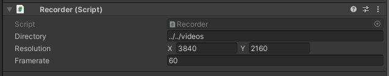

Videos are named `{trial index}_{ExperimentDefinition.ShortName}_roleIdx-{role index}_{parameter name}-{value}_..._{yy-MM-dd_hh-mm}`, where `hh` is the hour on a 12-hour clock.

### Experimenter dashboard
The host serves a dashboard at `http://<host ip>:8080` (the address is in the console; change the port with `-dashboardPort N`), to run an experiment from any computer, tablet or phone on the lab network, without walking to the host PC:
- start the host, choose the experiment (and for city maps the city, or a location), bind roles to the connected participants, choose the host's mode, initialise the experiment, start the simulation and go to the next trial;
- switch eHMIs, set the weather and time of day, trigger visual syncing;
- watch a live top-down map of the scene (rendered from the scene when it loads) with every participant (ringed), AV, AI car, SUMO vehicle, two-wheeler and pedestrian, and the traffic lights; see who is connected and ready, the trial and the frame rate.

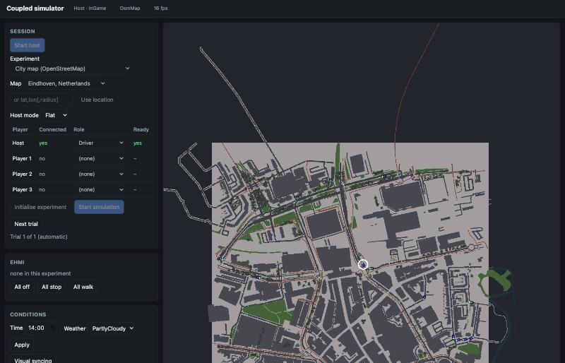

It needs no internet and no installation (a plain web page from the simulator). Allow TCP port 8080 in the host's firewall to use it from other devices. The `ExperimentDashboard` component sits on `Managers` in `StartScene`.

## Controls
| Who | Action | Keyboard | Steering wheel / gamepad |
| --- | --- | --- | --- |
| Driver | Throttle / brake | `W`/`S` or `↑`/`↓` (axis `Throttle`) | pedals |
| Driver | Steer | `A`/`D` or `←`/`→` | wheel |
| Driver | Brake (axis `Break`) | `Space` | pedal |
| Driver | Forward / reverse gear (reverse engages at standstill; then the throttle drives backwards, up to 25 km/h) | `F` / `R` | buttons of the wheel profile (G27: 6 / 7) |
| Driver | Blinker left / right / off | `Q` / `E` / `2` | buttons of the wheel profile (G27: 5 / 4 / 16) |
| AV passenger | eHMI disabled / stop / walk | `1` / `2` / `3` | |
| AV passenger | Resume driving where the AV waits for input (`WaitInputX`) | `Space` | |
| AV driver | Take over after a take-over request / hand back to the automation | `Enter` (or steer, brake, accelerate) | profile button (G27: 3), wheel, pedals |
| Experimenter | Take-over request | `T` | |
| Pedestrian (keyboard mode) | Walk forward / back, sideways, turn; run | `W`/`S`, `A`/`D`, `Q`/`E` (or arrows); hold `Shift` | |
| Pedestrian (keyboard mode) | Look around | hold the right mouse button and move the mouse | |
| Pedestrian (HMD) | Recenter the headset | `R` | |
| Host | Next trial (automatic trials) / show-hide GUI | `Esc` / `Tab` | |
| Experimenter | Steering wheel calibration window | `F2` | |

With a steering wheel, the car's steering wheel turns as far as the real one, without smoothing; keyboard steering is smoothed and steers less at speed. The steering wheels of AVs and of other agents' cars follow how those cars turn. The keyboard pedestrian walks at 1.4 m/s (runs at 3.5 m/s) with a walking animation.

Keyboard bindings are set in `Edit` ➡️ `Project Settings` ➡️ `Input Manager`; wheels and pedals through their profile and calibration (see [Hardware](#steering-wheels-pedals-and-gamepads)). The host can also switch eHMIs and trigger [visual syncing](#data-logging) from its GUI during the simulation.

## Environment and vehicles

The town (`MainScene`, with a night version `MainScene-night`) is a model of a US-like city with:
- a network of 2-lane roads, a loop of 4-lane road and a loop of 6-lane road (partially surrounded by buildings);
- a half-clover interchange for the motorway;
- 10 intersections with traffic lights that can be turned on and off before the experiment or programmatically at runtime;
- 34 zebra crossings;
- static objects (buildings, parked cars, trees).

`DriverTestScene` is a small scene for trying out the driven car.

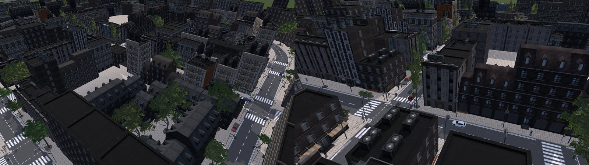
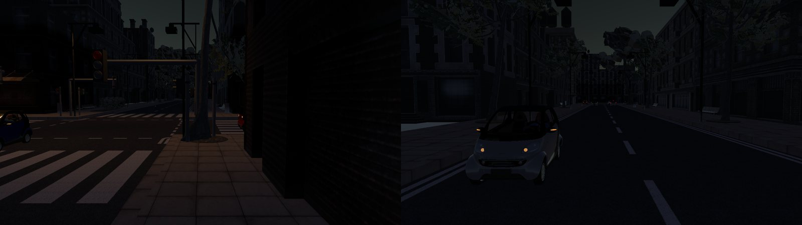

### City maps (OpenStreetMap)
Besides the hand-built town, experiments can take place in real city centres, built from [OpenStreetMap](https://www.openstreetmap.org) data while the scene loads (in 1-2 s), much like CARLA's towns: roads with their real widths and markings, red cycle paths, raised pavements with kerbs, zebra crossings (with `PedestrianCrossing`s for AI pedestrians), buildings at their mapped height with brick, plaster or concrete façades, parks, water, mapped trees and street lamps. Every agent builds the same map from the same data. Each map has a SUMO scenario with cars and bicycles on the same streets (`Assets/StreamingAssets/Sumo/Maps`).

| Continent | Maps (population) |
| --- | --- |
| Europe | Eindhoven (240k), Delft (105k), London (8.9M)\*, Barcelona (1.6M), Ghent (265k) |
| Asia | Tokyo, Shibuya crossing (14M)\*, Ho Chi Minh City (9M), Luang Prabang (56k) |
| Africa | Cairo (10M), Nairobi (4.4M)\*, Stellenbosch (175k)\* |
| North America | New York, Midtown (8.3M), Montreal (1.8M), Boulder (105k) |
| South America | São Paulo (11.5M), Montevideo (1.3M), Cusco (430k) |
| Oceania | Sydney (5.3M)\*, Auckland (1.7M)\*, Wellington (215k)\* |

\* left-hand traffic: spawn points and SUMO traffic keep left, and the participant's car is right-hand drive.

**Right-hand drive.** In cities with left-hand traffic the participant's car (driver and AV passenger roles) has its steering wheel on the right: the body and interior are mirrored, and the driver, passenger, steering wheel, instruments, mirrors and cameras move to the other side; the instrument text stays readable and the driving physics do not change. Each role chooses this with **Steering** in the experiment's role list (`Auto`: right in left-hand-traffic cities; `Left`; `Right`, also in the town). AI cars keep the steering wheel on the left.

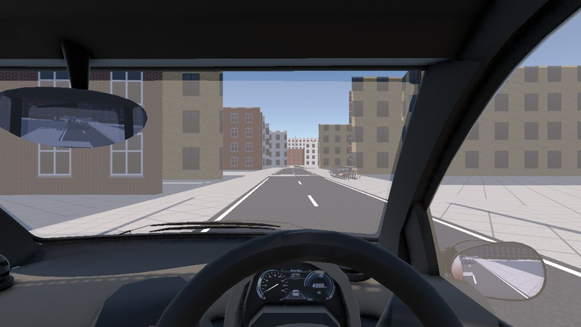

**Choosing a map.** Use the `City map (OpenStreetMap)` experiment (`Assets/ExperimentDefinitions/CityMap.prefab`, scene `OsmMap`): the host picks the city in its GUI, or a trial sets it with the parameter `map` (e.g. `map=Tokyo`). The roles (driver, pedestrian, cyclist, e-scooter and moped rider, second driver) use `OsmSpawnPoint`s, which put them on a driving lane, a pavement, a cycle path or the road edge near the map centre, so the experiment works in every city. Time of day uses the city's location and time zone.

**Driving anywhere.** The trial parameter `location=lat,lon[,radius]` (e.g. `location=51.4479,5.4904,350` for the TU/e campus) builds a map of any place: the OpenStreetMap data (radius 100-1000 m, default 400 m) is downloaded the first time (internet needed) and cached in the simulator's data folder; with SUMO installed, a SUMO network and random traffic for the place are built too. The host sends the location to the clients. To add a place to the catalogue for good, save its `.osm.gz` in `Assets/StreamingAssets/Maps` and add it to `MapCatalog`.

**Real 3D buildings (Netherlands).** For Dutch maps the buildings come from the [3D BAG](https://3dbag.nl) instead of OpenStreetMap: every building's measured shape with its real roof (gabled canal houses in Delft, flat-roofed blocks in Eindhoven), placed at its real position. Roofs get red or anthracite roof tiles. The façades (brick, plaster or concrete) have windows in the style of the building's construction year from the 3D BAG: tall sash windows before 1920, ribbon windows on post-war blocks, glass curtain walls on newer offices and towers (on other maps chosen by height and OpenStreetMap building type). The data is in `Assets/StreamingAssets/Maps/<Map>.buildings.bin.gz` (Delft and Eindhoven); to make it for another Dutch map in the catalogue (internet needed, about a minute):

```bash
python3 Tools/bag3d_buildings.py Delft
```

**Real 3D buildings (Japan).** Tokyo's buildings come from [Project PLATEAU](https://www.mlit.go.jp/plateau/), the open 3D city models of Japan's Ministry of Land, Infrastructure, Transport and Tourism (MLIT): LoD2 roofs and walls where PLATEAU has them, else LoD1 blocks with their measured height, up to the 229 m of Shibuya Scramble Square. Buildings over a road (station buildings, passages) are raised 5 m, so the road under them stays open. To make the file for another Japanese map, give the CityGML zip of its ward from the dataset page on [geospatial.jp](https://www.geospatial.jp/ckan/dataset?q=plateau) (only the 1 km tiles of the map are downloaded):

```bash
python3 Tools/plateau_buildings.py Tokyo https://assets.cms.plateau.reearth.io/assets/e5/29b4f5-f0bf-433d-8f98-deb594bfbebd/13113_shibuya-ku_pref_2023_citygml_2_op.zip
```

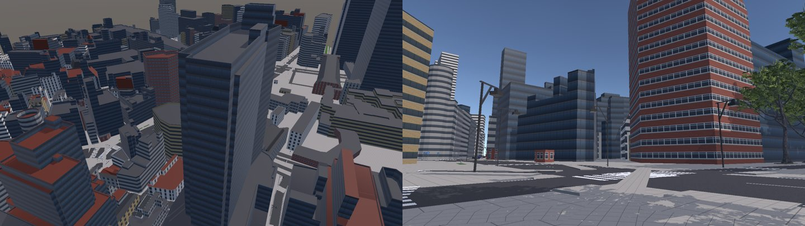

Maps without such a file use the OpenStreetMap buildings.

**Street furniture and parked vehicles.** From the OpenStreetMap data the map also gets benches, waste bins, bicycle racks with parked bicycles, bollards, bus stops (sign, and shelter with bench where mapped), café terraces, recycling containers, street cabinets, garden walls, fences and hedges, and parked cars in parking lots, parking spaces and along streets with street-side parking (at most 250 cars and 400 bicycles, those nearest the centre, so the frame rate stays up). Placement is the same on every agent. The parked bicycle and car prefabs are in `Assets/Prefabs/Props`; to rebuild them after changing the bicycle or car models use `Coupled Sim` ➡️ `Maps` ➡️ `Build street props`.

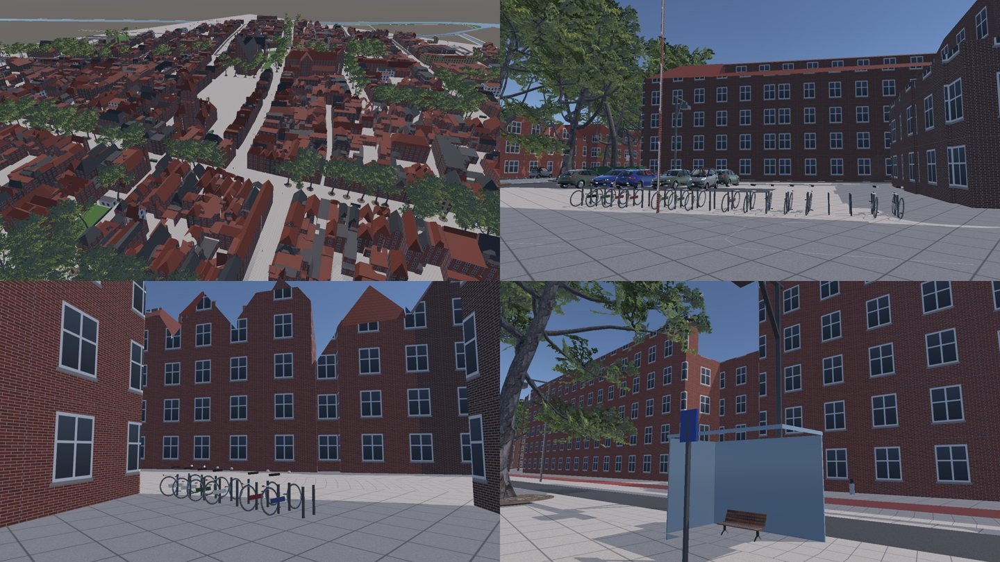

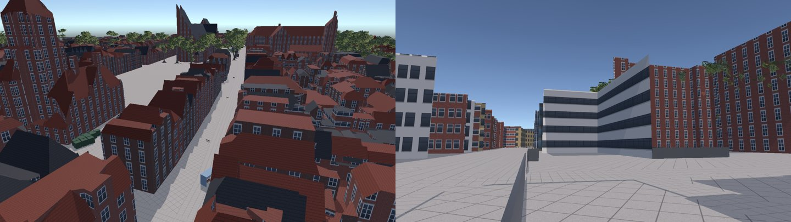

**Road networks from OpenDRIVE or SUMO.** A map can also be an [OpenDRIVE](https://www.asam.net/standards/detail/opendrive/) file (`.xodr`) or a SUMO network (`.net.xml` or `.net.xml.gz`): put it in `Assets/StreamingAssets/Maps` and set the trial parameter `map` to its file name (e.g. `map=GridTown.xodr`; a full path also works). The roads are built like those of the city maps: lanes with their widths, markings, pavements and cycle lanes (from the network's pedestrian and bicycle lanes), traffic signals, speed limits, street lamps; spawn points work the same. There are no buildings. With SUMO installed, the `City map` experiment's SUMO traffic runs on these maps too: random cars and bicycles made with SUMO's `randomTrips` the first time (cached). OpenDRIVE files are converted by SUMO's `netconvert`, which must be installed (with `SUMO_HOME` set, as for [traffic from SUMO](#traffic-from-sumo)); the result is cached in the simulator's data folder. The sample `GridTown.xodr` (a 4 × 4 grid) is included, and the same network as `GridTown.net.xml.gz`, which works without SUMO. A network without geographic reference gets Eindhoven's latitude for the sun.

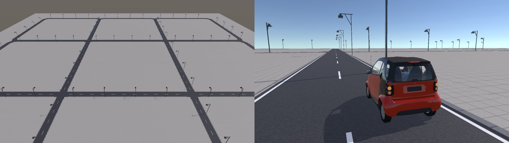

Limitations: outside the Netherlands, building shapes and heights are as good as the OSM data (buildings without a height get 3.5 floors), roofs are flat; façades come from five window styles, not the real buildings; traffic lights in the map are not shown (SUMO runs its own signals); roads have no elevation (bridges are only slightly raised).

Map data © OpenStreetMap contributors, available under the [Open Database License](https://www.openstreetmap.org/copyright). Dutch buildings: [3D BAG](https://3dbag.nl) by the 3D geoinformation group of TU Delft and 3DGI, under [CC BY 4.0](https://creativecommons.org/licenses/by/4.0/). Tokyo's buildings: source 3D都市モデル（Project PLATEAU）渋谷区（2023年度）([G空間情報センター](https://www.geospatial.jp/ckan/dataset/plateau-13113-shibuya-ku-2023)), converted to the simulator's format; used under the Public Data License 1.0 ([PLATEAU site policy](https://www.mlit.go.jp/plateau/site-policy/), compatible with CC BY 4.0).

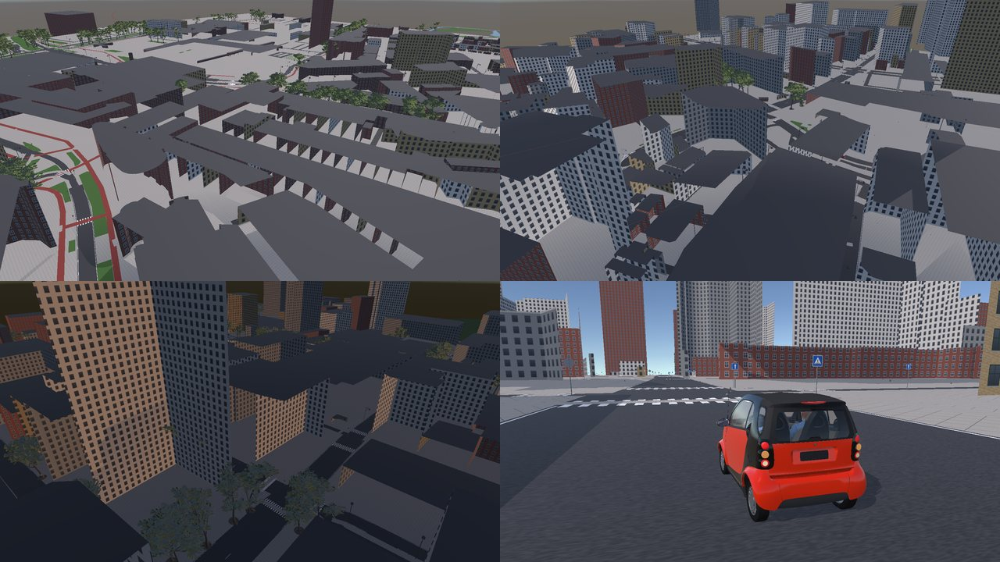

### Traffic signs
`TrafficSign` draws a sign on a pole: stop, give way, speed limit (any number), pedestrian crossing, no entry, one way, priority road, children; in the style of the Vienna Convention used in Europe, made from code (no third-party assets). Add one with `GameObject` ➡️ `Coupled Sim` ➡️ `Traffic sign` and turn its blue (forward) axis towards the traffic it is for. City maps place them from OpenStreetMap: stop and give-way signs where mapped, pedestrian crossing signs at zebra crossings, speed limits at the start of longer roads (`maxspeed`), one-way and no-entry signs at one-way streets; on the left of the road where traffic drives on the left.

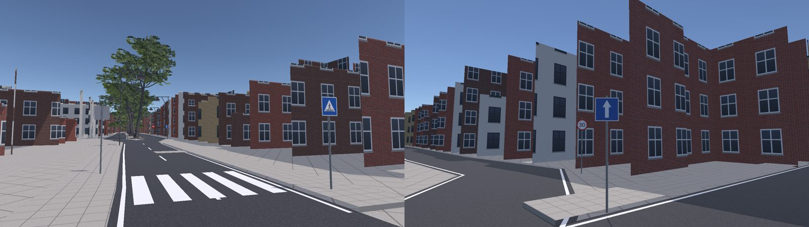

### Vehicles
The repository contains these drivable car prefabs in `Assets/Prefabs/Cars`:
1. small (similar to a Smart Fortwo): `DrivableSmartCommon` (and `DrivableSmartCommon-no_driver`);
2. medium (similar to a 2011 Ford Focus): `DrivableHatchbackCommon`;
3. medium (similar to a Pontiac GTO): `DrivableFireGTOCommon`;
4. large (similar to a Nissan Datsun): `DrivableNissanCommon`.

Only the Smart prefabs are in the `Avatar Prefab Driver` list of `Managers` ➡️ `PlayerSystem` by default. To use another car for a role, add its prefab to that list and point the role's `carIdx` to it. AI cars spawned by car spawners must also be in the `Prefabs` list of `NetworkingManager` ➡️ `AI Car System`.

AI cars follow a defined path (see [waypoints](#configuration-of-waypoints)) or can be programmed to react at runtime to other road users.

**Driving physics.** The participant's car drives with `RealisticVehicleDynamics` (on the drivable car prefabs; `Car` = `SmartFortwo` or `Hatchback`): the real mass, centre of mass and inertia of the car; suspension tuned to its mass (`SuspensionFrequency`, `DampingRatio`); tyre grip for asphalt that drops on wet roads (`WetGrip`, with the rain of the [weather](#time-of-day-and-weather)); an engine with torque curve and maximum power, an automatic gearbox (early shifts when driving gently, kick-down), engine braking and an auto-hold at standstill; front/rear brake balance with ABS; anti-roll bars; Ackermann steering geometry; with the keyboard, steering is reduced at speed. The Smart (52 kW) reaches 60 km/h in about 6 s and stops from 70 km/h in under 2 s, as the real car. The models are in `Assets/Scripts/Vehicles/Models` with tests against the manufacturers' acceleration and top speed figures. Remove the component to drive with the original arcade physics.

## Networking
- Agents communicate over UDP with Unity Transport on **port 7770**. Allow this port (or the Unity editor / the built simulator) through the firewall on every PC.
- The number of agents is fixed in code to 4 (`UNetConfig.MaxPlayers`): the host plus three clients.
- The host runs the simulation (AI cars, AI pedestrians, traffic lights) and sends poses to the clients; each client sends the pose of its own avatar to the host.
- `Visual syncing` (host GUI, during the simulation) shows a red bar on all agents for 1 s, to synchronise screen recordings afterwards.

## Data logging
Every agent writes binary logs to the `ExperimentLogs` folder in the project folder (next to `Assets`):
- `HostLog-{role}-{yyyy_MM_dd_HH_mm_ss}.binLog` / `ClientLog-...`: one frame per rendered frame;
- `HostFixedTimeLog-{role}-...` / `ClientFixedTimeLog-...`: one frame per physics step, at a fixed 50 Hz (`Fixed Timestep` 0.02 s).

Each frame contains the time, the position and rotation of every car with its blinkers, front lights and stop lights, AI-car state (speed, braking, stopped, take-off, eye contact), the position and rotation of every bone of every pedestrian (players and AI; with the Xsens suit, the suit's pose at the time of the frame), and the state of every traffic light. Experiment `Points of Interest` are stored in the log header.

**Convert to CSV.** In `Play Mode`, before pressing `Start host` or `Start client`, press `Convert log to csv`, pick a log and a reference frame (the world origin, a point of interest of the experiment, or a custom point). The result is a semicolon-separated file `ExperimentLogs/{reference}-{log name}.csv` with positions relative to that reference.

**Replay.** Every log has a small `.replay.json` file next to it with the experiment, scene, city map, time of day, weather and the vehicle and pedestrian models. In `Play Mode`, before `Start host` or `Start client`, press **Replay a recording** and pick a recording (newest first): the simulator loads that world and plays the trial back with every participant, AI car and traffic light, without network or new logs. At the bottom: a time slider, play/pause and speed, and buttons to follow a participant. Keys: `Space` play/pause, `←`/`→` 5 s back/forward, `-`/`+` slower/faster (0.1× to 8×), `1`-`9` follow participant 1-9, `C` the participant's own view or from behind, `0` free camera (`W` `A` `S` `D`, `Q`/`E` down/up, `Shift` faster, hold the right mouse button to look around), `T` trails of the participants' paths, `Esc` back to the start screen. Logs from before the replay existed have no `.replay.json`: they are listed as "older"; after clicking one, choose the experiment it was recorded in (and the city map, for map experiments), and the replay uses the standard car and pedestrian models. Logs from much older versions of the simulator may be in a different format and cannot be read. From the command line: `-replay ExperimentLogs/<log>.binLog` (for older logs add `-replayExperiment <short name>` and, for map experiments, `-replayMap <map>`).

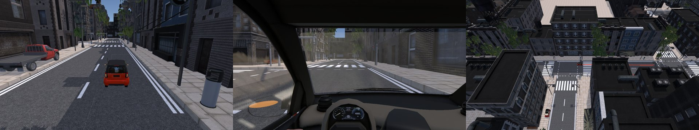

**Live data.** The per-frame logger of each agent also sends its frames over UDP to `localhost:40131`, every `NetworkingManager` ➡️ `Realtime Log Interval` seconds (default 0.2 s; read when the simulator starts), so experiments can be monitored with external tools. `Tools/log_receiver.py` is an example receiver: start it with `python log_receiver.py` (Python 3) from the `Tools` folder before starting the simulation. Packets start with a type (`1` = begin, `2` = frame). A received frame looks like this:
```
{
   "timestamp":1.711700439453125,
   "roundtrip":0.0,
   "Driver [car index]":{ # the car of the local player
      "position":(-94.58, -0.06, 64.84),
      "rotation":(0.53, 90.87, 359.99),
      "blinker":0,
      "front":false,
      "stop":false,
      "rigidbody":(3.12, -0.003, -0.047)
   },
   "Driver [car index]":{ # one entry per AI car
      "position":(-112.08, -0.06, 21.38),
      "rotation":(0.51, 157.48, -0.003),
      "blinker":0,
      "front":false,
      "stop":false,
      "rigidbody":(0.51, -0.002, -1.22),
      "speed":5.90,
      "braking":false,
      "stopped":false,
      "takeoff":false,
      "eyecontact":false
   },
   "Pedestrian [pedestrian index]":{ # one entry per player or AI pedestrian
       "bone [bone index]":{ # one entry per bone of the pedestrian rig
          "position":(-94.58, -0.06, 64.84),
          "rotation":(0.53, 90.87, 359.99)
       }
   },
   "CarLight [index]":{ "state":"b""\\x00" },        # one entry per car traffic light
   "PedestrianLight [index]":{ "state":"b""\\x02" }  # one entry per pedestrian traffic light
}
```

### Exporting the road network
`Coupled Sim` ➡️ `Maps` ➡️ `Export road network` writes the road network of the loaded world to `ExperimentLogs` (city maps: in Play mode), for analysis together with the logs:
- `RoadNetwork-{name}.geojson`: roads (OSM type, width, one-way), cycle paths, pavements, pedestrian crossings, traffic lights, traffic signs and the waypoint paths of AI cars and pedestrians; in longitude/latitude on city maps (with the scene coordinates of every point in `scene_xz`), in scene coordinates otherwise;
- `RoadNetwork-{name}.obj`: the road, pavement and crossing surfaces as meshes, in scene coordinates.

City maps write these files by themselves the first time they are built.

For the hand-built town (`MainScene`) in batch mode: `Unity -batchmode -quit -projectPath . -executeMethod RoadNetworkMenu.ExportScene -scene Assets/_Scenes/MainScene.unity` (the experiments in that scene add their paths, crossings and lights).

## Configuration
### Experiment definitions
The central configuration is on the `Managers` game object in `StartScene`:
- `PlayerSystem`: the player avatar prefabs (pedestrian avatar and the `Avatar Prefab Driver` list of cars);
- `NetworkingManager`: the list of experiments, the trial sequence, and the prefabs of AI cars that can be spawned during an experiment (`AI Car System` ➡️ `Prefabs`).

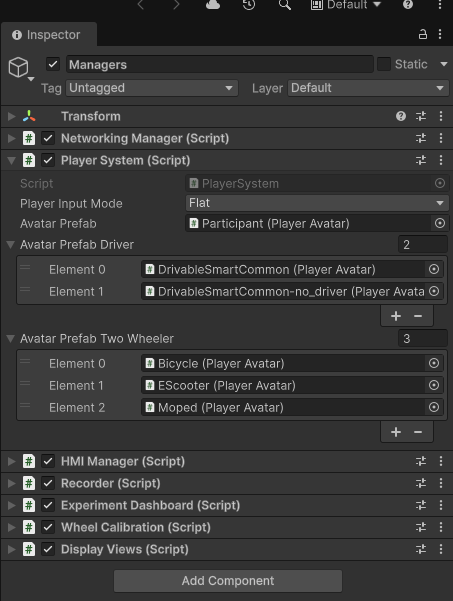

An experiment is a prefab with an `ExperimentDefinition` component on its root object. To make a new experiment selectable, add its prefab to the `Experiments` list of `NetworkingManager` (or right-click it ➡️ `Coupled Sim` ➡️ `Register experiment in StartScene`). `Assets/ExperimentDefinitions` contains `Base` (the example used by default, showing most features) and the experiments of earlier studies: `2Pedestrian`, `EvasiveManeuvers`, `Scenario_1_eHMI`, `SoloAuto`, `SoloPedestrian`, `SoloPedestrianWithNPCs-Nighttime` and `TrolleyProblem`.


To edit an experiment, double-click its prefab in the `Project` window.

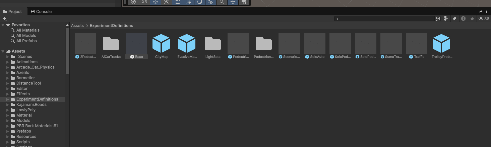

The prefab opens in prefab mode with the `Regular Prefab Editing Environment`. It helps to set this environment to the experiment's scene (`Edit` ➡️ `Project Settings` ➡️ `Editor` ➡️ `Prefab Editing Environments` ➡️ `Regular Environment`).

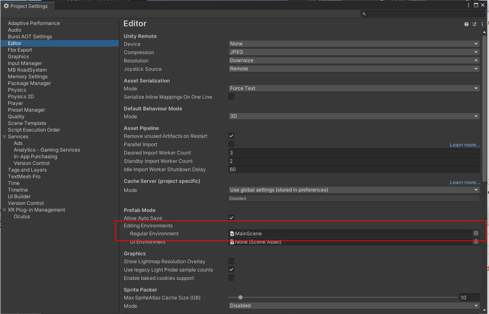

#### Setting up a new experiment
`Coupled Sim` ➡️ `Experiments` ➡️ `Setup…` creates experiments without editing lists by hand:
1. `New experiment`: give a name and short name, pick a template (one of the registered experiments: `Base` for the hand-built town, `CityMap` for city maps), where it takes place (the template's scene, one of the [city maps](#city-maps-openstreetmap), or any place by coordinates), the roles to keep, background traffic, animals, time of day and weather. `Create and register` copies the template to `Assets/ExperimentDefinitions`, adds it to `NetworkingManager` ➡️ `Experiments` and its scene to the build settings.
2. `Open it to place spawn points` opens the experiment in its scene: move the spawn points, waypoint paths and spawners, then apply the overrides to the prefab. On city maps, spawn points (`OsmSpawnPoint`) find a road lane, pavement or crossing near the map centre by themselves.
3. `Trials`: make a [trial file](#trial-files-and-counterbalancing) and preview each participant's order.
4. `Check`: lists problems: experiments without roles or spawn points, cars or two-wheelers missing from `PlayerSystem`'s lists, AI car prefabs missing from `AI Car System` ➡️ `Prefabs`, scenes or maps that do not exist, duplicate role names, trials pointing to experiments or roles that do not exist, experiment prefabs that are not registered.

The same check runs when you press Play in `StartScene` (and adds missing experiment scenes to the build settings); it asks before playing when there are errors. Turn it off with `Coupled Sim` ➡️ `Experiments` ➡️ `Check experiments before Play`, or run it with `Coupled Sim` ➡️ `Experiments` ➡️ `Validate`.

`ExperimentDefinition` has these fields:
- `ShortName`: short name, used in video file names;
- `Name`: name shown in the host GUI;
- `Scene`: the Unity scene loaded as the environment (it must be in the build settings); empty for city maps;
- `Map`: the [city map](#city-maps-openstreetmap) (`MapCatalog` name or `lat,lon[,radius]`) built in the `OsmMap` scene; empty for hand-built scenes;
- `Roles`: the roles participants can take (see below);
- `Points of Interest`: `Transform`s whose positions are stored in the logs, for analysis and as CSV reference frames;
- `Car Spawners`: objects with a component derived from `CarSpawnerBase` that spawn AI cars. The spawn sequence is the `IEnumerator SpawnCoroutine()` of the component (see `BaseSyncedCarSpawner`). Spawned prefabs must be in `NetworkingManager` ➡️ `AI Car System` ➡️ `Prefabs`. A spawner without spawn point, track or car prefab logs a warning and spawns nothing;
- `AI Pedestrians`: pairs of an `AIPedestrian` (the pedestrian avatar in the prefab) and a `WaypointCircuit` (its path).

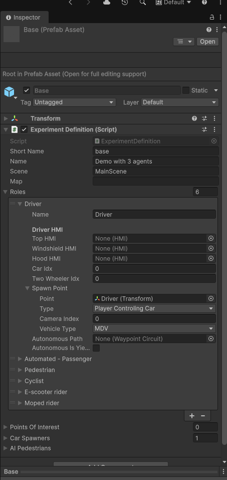

### Configuration of agents
The roles are in `ExperimentDefinition` ➡️ `Roles` (see the picture above).

`Roles` is a list of `ExperimentRoleDefinition`s with these fields:
- `Name`: short name of the role;
- `SpawnPoint.Point`: where the avatar is spawned;
- `SpawnPoint.Type`: the kind of avatar: `PlayerControlledPedestrian`, `PlayerControlingCar` (driver of a manual car), `PlayerInAIControlledCar` (passenger of an AV) or `PlayerRidingTwoWheeler` (cyclist, e-scooter or moped rider);
- `SpawnPoint.CameraIndex`: which camera of the avatar is used (see below);
- `SpawnPoint.VehicleType`: for cars, `AV` or `MDV` (manually driven vehicle); it enables the matching `AV` or `MDV` elements of the car's `PlayerAvatar`;
- `carIdx`: for cars, the index of the car prefab in `PlayerSystem` ➡️ `Avatar Prefab Driver`;
- `twoWheelerIdx`: for two-wheeler riders, the index in `PlayerSystem` ➡️ `Avatar Prefab Two Wheeler` (0 bicycle, 1 e-scooter, 2 moped);
- `TopHMI`, `WindshieldHMI`, `HoodHMI`: for AV passengers, the eHMI prefab spawned on each slot (slots are set on the car's `PlayerAvatar` ➡️ `HMI Slots`);
- `AutonomousPath`: for AV passengers, the `WaypointCircuit` the AV follows;
- `AutonomousIsYielding`: puts the AV on the `Yielding` layer instead of `Car`.

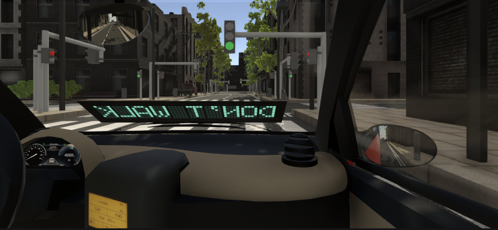

**Adding and removing agents.** Increase the size of `Roles`, or right-click a role and choose `Duplicate`. To remove one, right-click it and choose `Delete`.

**Starting location.** Add a game object to the experiment prefab, place and rotate it, and drag it to `SpawnPoint.Point`.

**Camera.** An avatar prefab can have several cameras (`PlayerAvatar` ➡️ `cameras`), for example for the driver's and the passenger's seat; `SpawnPoint.CameraIndex` selects one. A `CameraSetup` component on the `SpawnPoint.Point` object sets `Field Of View` and `Rotation` (local rotation) of the avatar's cameras at spawn time.

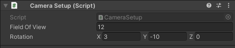

### Configuration of waypoints
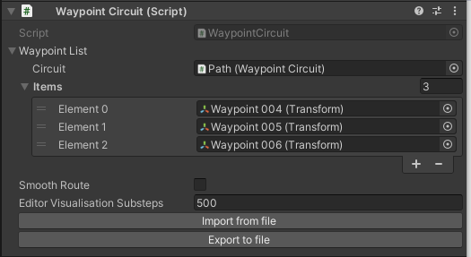

Paths of AI pedestrians and cars are `WaypointCircuit` components with a list of waypoint `Transform`s:
- add a waypoint: press `+` below the list and drag a `Transform` into the new field;
- remove a waypoint: select it in the list and press `−`;
- reorder: drag an item in the list;
- move: select the waypoint object and move it in the scene.

#### AI pedestrians
A trigger `BoxCollider` with a `PedestrianWaypoint` component on a waypoint changes how the pedestrian walks from there on:
- `targetSpeed`: walking speed (m/s);
- `targetBlendFactor`: animation blend between standing (0) and full walking (1).

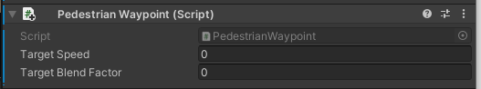

#### Pedestrian behaviour models
By default (`Behaviour` = `WaypointsOnly`) AI pedestrians walk their path at the set speed, exactly as in earlier experiments. With `Behaviour` = `BehaviourModels` on the `AIPedestrian` component they behave like individuals:
- **Individual parameters**, drawn per pedestrian from a seeded random generator (`Seed`, or derived from the object name, so trials repeat exactly) for its `AgeGroup` (adult, child, older): free walking speed N(1.34, 0.26) m/s (Weidmann, 1993), a slightly higher speed on the road, critical gap (log-normal, median 4.5 s; Brewer et al., 2006), reaction time, the deceleration at which a car is seen as yielding, trust in eHMIs and patience. Children and older people walk slower; older people choose larger gaps.
- **Crossing decisions (gap acceptance)** at `PedestrianCrossing`s: the pedestrian stops at the kerb, looks for at least 0.8 s and crosses when every approaching car either arrives later than the required gap (the larger of the critical gap and the time to clear that car's lane plus a safety margin) or is seen to yield: it is stopped, brakes hard enough to stop before the crossing, or shows `WALK` on its eHMI (trusted with the pedestrian's `EhmiTrust` probability). A `STOP` eHMI makes pedestrians more careful. The accepted gap shrinks the longer one waits (impatience). Pedestrians step off after their reaction time and hurry when a non-yielding car gets close while they are on the road.
- **Collision avoidance** between pedestrians (including player pedestrians) with the social force model (Helbing & Molnár, 1995) with anticipation (Johansson et al., 2007).
- **Animation**: the walk animation follows the actual speed (no foot sliding), the head and eyes follow approaching traffic at the kerb (or scan left and right) and while crossing, and the feet are placed on kerbs (foot IK). Turn these off with `MatchAnimationToSpeed`, `LookAtTraffic` and `FootIK`.

A `PedestrianCrossing` is a trigger collider at the near kerb with a `FarKerb` target on the other side; `Zebra` marks zebra crossings (pedestrians accept 15% smaller gaps there). `VehicleTracker` estimates speed and acceleration of every car for the pedestrians (it also works for remote, player-driven cars).

Every decision is written to `ExperimentLogs/PedestrianDecisions-{date}.csv` (time, pedestrian, event `arrived at kerb` / `start crossing` / `crossed`, waiting time, number of approaching and yielding vehicles, smallest time to arrival, critical gap, walking speed, reason).

**More pedestrians.** `Assets/Prefabs/AIPedestrians/Rocketbox` contains 12 pedestrians (women, men, children, business and sports outfits) made from the [Microsoft Rocketbox](https://github.com/microsoft/Microsoft-Rocketbox) avatars (MIT). `Coupled Sim` ➡️ `Pedestrians` ➡️ `Build pedestrian prefabs from Rocketbox avatars` rebuilds them; to add more, copy an avatar folder (FBX and textures) from the Rocketbox repository into `Assets/ThirdParty/Rocketbox` and run the menu item again. The logged bones of these prefabs are the same humanoid bones as those of the other pedestrians, but bone rotations depend on each rig.

**Example.** The `PedestrianCrossings` experiment (made with `Coupled Sim` ➡️ `Examples` ➡️ `Create PedestrianCrossings experiment`) adds eight of these pedestrians to `Base`, walking a loop that crosses the road south of the central block twice where the AV of the `Automated - Passenger` role drives. `ExperimentPedestrianTools` has the helpers it uses (create a path, a crossing, add a group of pedestrians to an experiment).

#### AI cars
A trigger `BoxCollider` with a `SpeedSettings` component on a waypoint changes the car's behaviour when it reaches it:
- `Type`: `InitialSetSpeed` (at the spawn point; sets the initial speed to `speed`, or to 0 if `causeToYield`), `SetSpeedTarget` (regular waypoint) or `Delete` (removes the car);
- `speed`: target speed (km/h);
- `acceleration`: acceleration to reach the target speed (m/s²; negative to slow down);
- `jerk`: rate of change of acceleration;
- `BlinkerState`: blinker to switch on;
- `causeToYield`: the car brakes with `brakingAcceleration` (negative) to a stop, waits `yieldTime` seconds and drives on with `acceleration` up to `speed`;
- eye-contact fields, see [eye contact](#configuration-of-drivers-eye-contact);
- `customBehaviourData`: triggers custom behaviour (below).

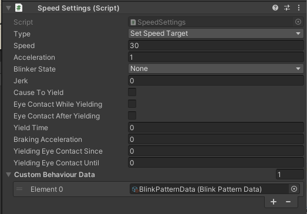

**Custom behaviour.** A waypoint can trigger custom behaviour of an `AICar` by referencing a `ScriptableObject` derived from `CustomBehaviourData`; the car needs a matching `CustomBehaviour` component, linked at spawn time (see `BlinkWithFrontLights`, `BlinkPatternData` and `BaseSyncedCarSpawner`).

#### Exporting and importing waypoint circuits
`WaypointCircuit` has `Export to file` and `Import from file` buttons. The file is a semicolon-separated CSV whose first line is `Smooth: True` or `Smooth: False`, followed by a header and one row per waypoint. Importing replaces all waypoints of the circuit. The columns are:

1. `GameObject`: `name`, `tag`, `layer` (layer index).
2. `Transform`: `x`, `y`, `z` (position, m), `rotX`, `rotY`, `rotZ` (Euler angles, degrees), `scaleX`, `scaleY`, `scaleZ`.
3. `SpeedSettings`:

| Field | CSV column | Values |
| --- | --- | --- |
| Type | waypointType | 0 InitialSetSpeed, 1 SetSpeedTarget, 2 Delete |
| speed | speed | km/h |
| acceleration | acceleration | m/s² |
| jerk | jerk | m/s³ |
| BlinkerState | blinkerState | 0 none, 1 left, 2 right |
| causeToYield | causeToYield | True/False |
| EyeContactWhileYielding | lookAtPlayerWhileYielding | True/False |
| EyeContactAfterYielding | lookAtPlayerAfterYielding | True/False |
| yieldTime | yieldTime | s |
| brakingAcceleration | brakingAcceleration | m/s² |
| YieldingEyeContactSince | lookAtPedFromSeconds | s |
| YieldingEyeContactUntil | lookAtPedToSeconds | s |
| customBehaviourData | customBehaviourDataString | `%`-separated `{asset name}#{entity id}` pairs (valid within one editor session) |

4. `BoxCollider`: `collider_enabled`, `isTrigger` (True/False), `centerX`, `centerY`, `centerZ`, `sizeX`, `sizeY`, `sizeZ`.

### Cyclists, e-scooter and moped riders
Roles with `SpawnPoint.Type` = `PlayerRidingTwoWheeler` let a participant ride a bicycle, an e-scooter or a moped (`twoWheelerIdx` 0, 1, 2 in `PlayerSystem` ➡️ `Avatar Prefab Two Wheeler`). `Base` and the example experiments have the roles `Cyclist`, `E-scooter rider` and `Moped rider`.
- **Physics** (`TwoWheelerDynamics`, with tests): force balance of the rider's pedalling power (city bike: about 18-25 km/h on the flat at full effort) or motor power with the legal cut-off speed (e-bike and e-scooter 25 km/h, moped 25 or 45 km/h), rolling resistance, air drag, slope and braking (bicycle: about 3 m from 20 km/h); a bicycle model for the yaw, with the steering range narrowing with speed and the rider leaning into turns (equilibrium lean, reached with a lag). The vehicle follows the ground, can mount kerbs up to 18 cm and stops when it hits something. Presets are in `TwoWheelerParameters.Preset`.
- **Controls**: the car's axes: `W`/`↑` pedal or throttle, `S`/`↓` or `Space` brake, `A`/`D` steer; steering wheel and pedals work the same.
- **Models**: the bicycle (Dutch city bike), e-scooter and moped are built from code by `Coupled Sim` ➡️ `Two-wheelers` ➡️ `Build avatar prefabs` (`TwoWheelerPrefabBuilder`): wheels spin, the handlebar turns on its head tube, frame and rider lean, the cranks turn when pedalling; the rider is a Rocketbox avatar whose hands and feet are placed on the grips and pedals (or footboard) by IK (`RiderIK`). The camera is at the rider's eyes and follows only part of the lean (`CameraLeanFactor`) for comfort in VR.
- Riders are logged and synchronised like vehicles (position, rotation, velocity; lean, steering and wheels as synced parts); AI pedestrians, model-driven traffic and SUMO (as a bicycle or moped) react to them.


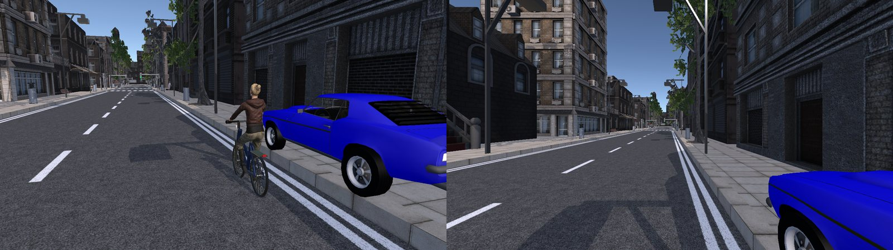

### Automated driving and take-over requests
The AV of a role with `SpawnPoint.Type` = `PlayerInAIControlledCar` gets an `AutomatedDriving` component when the participant is spawned. It drives in one of two modes (trial parameter `automation`):
- `Waypoints` (default): the speeds, accelerations and yielding set on the waypoints of its `AutonomousPath` (`SpeedSettings`, see [AI cars](#ai-cars));
- `TrafficModel`: smooth car following with a [car-following model](#configuration-of-background-traffic) (IDM by default) at `avSpeed` km/h: it adapts its speed to the vehicle ahead, slows down for bends, and stops at red lights and for pedestrians and animals on the road.

A **take-over request** (TOR) hands the car to the participant: a red "TAKE OVER" warning in front of the driver's eyes (also in VR) and three beeps per second. The driver takes over by steering, braking or pressing the throttle (thresholds `SteerThreshold`, `PedalThreshold`) or with the `automation` button (`Enter`; on a wheel the profile's `Automation` button, G27: 3), and then drives with the full [vehicle physics](#vehicles). Without a reaction within `TimeBudget` seconds (trial parameter `takeOverBudget`, default 7 s), the AV brakes to a stop (minimal-risk manoeuvre; `WhenNoReaction` = `KeepDriving` lets it drive on). The `automation` button hands the car back to the automation, which continues from the nearest point of its path.

Requests come from:
- the trial parameter `takeOverAt` (seconds after the start; host);
- a `TakeOverPoint` on the road (a trigger collider; the AV issues the request when it drives into it);
- the experimenter: `T` on the machine of the participant, or `Take-over request` on the [dashboard](#experimenter-dashboard).

`ExperimentLogs/TakeOver-{date}.csv` lists the events (automation mode, request with its source, take-over with the input used and the reaction time, no reaction, engaged) with the time, speed and position.

### Scripted paths
A car can follow a path from a file instead of waypoints in the scene: a CSV with the columns `x` and `z` (scene coordinates in metres, as in the logs; `y` optional) and optionally `speed` (km/h) and `t` (seconds):
- with `t`, the car is where the file says at each moment (for example a trajectory recorded in an earlier trial or in naturalistic data);
- with `speed`, it follows that speed profile along the path and brakes in time (up to `MaxDeceleration`) for slower points ahead;
- otherwise it drives at `DefaultSpeedKmh`.

It slows down for bends (at most 2.5 m/s² sideways) and stops at the last point. Scripted cars do not yield to pedestrians or stop at lights: the file decides.

Files are looked up as given, then in `Assets/StreamingAssets/Paths`. A `ScriptedPathSpawner` (a car spawner: add it to the experiment's `Car Spawners`, with a car prefab from `AI Car System` ➡️ `Prefabs`) spawns a car at the start of the path after `Delay` seconds; the trial parameter `avPath` makes the participant's AV follow a path file. Example: `Assets/StreamingAssets/Paths/example_path.csv`.

### Configuration of background traffic
A `TrafficSpawner` in an experiment's `Car Spawners` list fills one or more lanes with AI cars that drive with a car-following model instead of the `SpeedSettings` script:
- `Lanes`: `WaypointCircuit`s (usually closed loops) and the number of cars on each; cars are spread along the lane and start tracking from where they are placed;
- `Model`: **IDM** (Intelligent Driver Model; Treiber, Hennecke & Helbing, 2000), **Gipps** (1981) or **Krauss** (1998; SUMO's default, with random "dawdling");
- `DesiredSpeedKmh` and `DesiredSpeedSdKmh`: each car draws its own desired speed from this normal distribution (seeded by `Seed`);
- `CarPrefabs` and `Colors` to pick from (prefabs must be in `NetworkingManager` ➡️ `AI Car System` ➡️ `Prefabs`);
- `YieldToPedestrians`, `ObeyTrafficLights`, `KeepClearOfPlayers` (m).

Each car gets a `TrafficCar` component that looks ahead along its own lane for the nearest car (also player cars, the AV and SUMO cars), a pedestrian on the road, or a red or yellow traffic light (stopping only if it can stop comfortably at yellow), slows down before bends (lateral acceleration up to `MaxLateralAcceleration`, 2.5 m/s²), and gives the speed to `AICar`, which steers along the waypoints and shows brake lights. Scripted AI cars in the same experiment, such as the AV, keep their script but get a collision-avoidance supervisor that caps their speed when a car is close ahead (it does not react to pedestrians or lights, which stay part of the experiment's script). The models and the MOBIL lane-change rule (Kesting, Treiber & Helbing, 2007) are in `Assets/Scripts/Traffic/Models` and have edit-mode tests.

The `Traffic` example experiment (`Coupled Sim` ➡️ `Examples` ➡️ `Create Traffic experiment`) adds IDM traffic in both directions on the roads around the central block (6 cars per direction, Smart and hatchback cars) to `Base`.

AI cars removed by a `Delete` waypoint are now hidden on all agents instead of destroyed, so networked pose updates keep working.

### Traffic from SUMO
[Eclipse SUMO](https://eclipse.dev/sumo/) can run the background traffic instead: for large networks, imported scenarios, or traffic studied with SUMO's own models. A `SumoBridge` in an experiment's `Car Spawners` list connects to SUMO over TraCI (no extra Unity packages):
- SUMO's vehicles appear as AI cars on all agents, interpolated between SUMO steps, placed on the road surface, with SUMO's colours, blinkers and brake lights; vehicles that leave SUMO are hidden and reused;
- the participants' cars and the AV are put into SUMO every step (`SendUnityCars`), so SUMO traffic follows and yields to them;
- SUMO cars stop for pedestrians (AI and players) on the road in front of them (`StopForPedestrians`);
- SUMO runs on its own thread in lockstep with Unity's clock, so the frame rate does not depend on SUMO.

Set-up: install SUMO (1.20 or newer; tested with 1.28) and set `SUMO_HOME`; the bridge then starts `$SUMO_HOME/bin/sumo` with `Sumo Config` (a `.sumocfg`, relative to `Assets/StreamingAssets`). Set `Sumo Binary` to `sumo-gui` to watch SUMO's view as well, or turn `Launch Sumo` off to connect to a SUMO already started with `--remote-port` (`Host`, `Port`; the command line option `-sumoConnect host:port` does the same, also for a SUMO on another PC). `Network Origin` places SUMO's coordinates in the scene (SUMO x along the transform's x, SUMO y along its z).

`Coupled Sim` ➡️ `Examples` ➡️ `Create SumoTraffic experiment` makes the `SumoTraffic` example: SUMO traffic in both directions around the central block of MainScene. `SumoTools.ExportLanes` writes the scene's lanes (`WaypointCircuit`s) as a SUMO network with looping routes and flows to `Assets/StreamingAssets/Sumo/MainScene` (SUMO coordinates = Unity x and z); after changing lanes, rebuild the network with the `netconvert` command in the README of that folder.

### Configuration of driver's eye contact
The `EyeContact` component on a car's driver sets the initial eye-contact behaviour:
- `Tracking`: whether the driver looks at pedestrians while the car moves (changes at runtime);
- `TrackingWhileYielding`: the same while the car is stopped;
- `MinTrackingDistance`, `MaxTrackingDistance` (m): range in which the driver can look at a pedestrian, measured horizontally between the driver's head and the pedestrian's root;
- `MaxHeadRotation` (degrees): limit of the head rotation around the vertical axis.

The driver looks at the closest object tagged `Pedestrian` within that range, if the rotation limit allows it. `EyeContactRigControl` animates the driver's head towards that target.

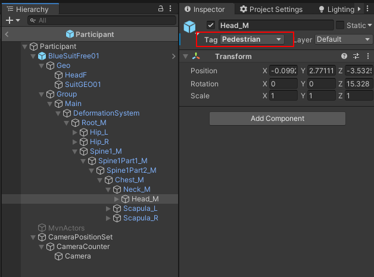

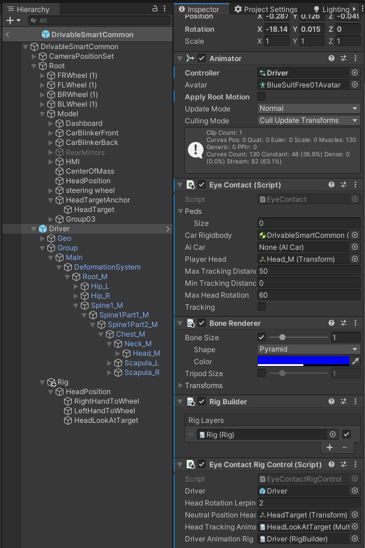

`SpeedSettings` on waypoints change eye contact when the car reaches them:
- `EyeContactWhileYielding`: behaviour while the car is stopped;
- `EyeContactAfterYielding`: behaviour after the car drives on again (overwrites `EyeContact.Tracking` once the car has stopped);
- `YieldingEyeContactSince`: seconds after stopping before the driver makes eye contact;
- `YieldingEyeContactUntil`: seconds after stopping when the driver stops making eye contact.

### Animals
Every experiment has an `AnimalSpawner` (child object `Animals`) that places animals around the first role's spawn point (or `Centre`) within `Radius` metres: by default 12 pigeons, 2 dogs, 2 cats and a fox (`CityMap`: 20 pigeons, 4 dogs, 3 cats and a fox); huskies, deer and horses are also available. They are the same on every agent (`Seed`). The host runs their behaviour and sends their poses to the clients:
- they idle, eat, and wander within `HomeRadius` of where they started, sometimes across the road;
- they flee from vehicles that would reach them within `FleeTime` seconds or come closer than `FleeDistance`, running sideways out of the car's path; pigeons fly off and land again;
- cats, pigeons, foxes, deer and horses also keep their distance from pedestrians (`PeopleShyDistance`; dogs are not shy);
- background traffic and SUMO cars stop for animals on the road (not for flying pigeons).

The experiment parameter `animals` multiplies the numbers per trial (`0` = no animals, `2` = twice as many). Positions and states are logged to `ExperimentLogs/Animals-{date}.csv` (time, animal, species, position, heading, state). The models are low-poly CC0 animals by Quaternius with their walk, run, idle and eating animations, scaled to real body lengths; `Coupled Sim` ➡️ `Animals` ➡️ `Build prefabs and add to experiments` (`AnimalPrefabBuilder`) rebuilds the prefabs.

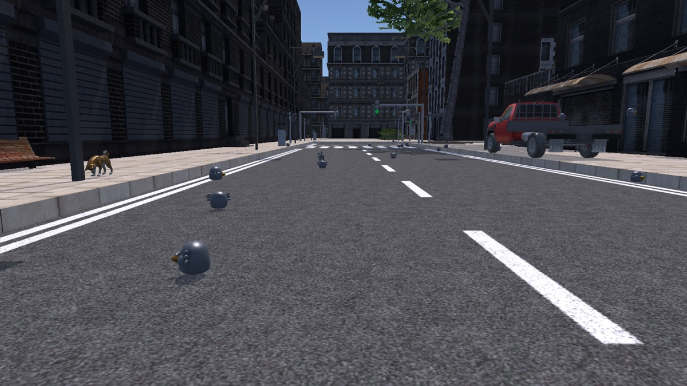

### Time of day and weather
Every experiment has an `EnvironmentController` (child object `Environment (time of day, weather)`) that sets:
- **time of day** (`TimeOfDay`, clock time; `Latitude`, `Longitude`, `UtcOffset`, `DayOfYear`): the sun's position from a solar model, its colour and strength, a physically based sky, ambient light and the street lights (a light under each `StreetLamp`, the nearest 24 to the viewer switched on at dusk); `TimeSpeed` lets time run (e.g. 60 = one minute per second);
- **weather** (`Clear`, `PartlyCloudy`, `Overcast`, `LightRain`, `HeavyRain`, `Fog`): clouds (sky colour, softer and weaker sunlight), fog, rain around the viewer and wet, darker, shinier roads and pavements; `ExtraFog` and `RainOverride` fine-tune it.
- **reflections** (`LiveReflections`, on by default): a realtime reflection probe a few metres above the viewer, renewed when the time of day or weather changes and when the viewer has moved 30 m (`LiveReflectionDistance`; 128 pixels per face, `LiveReflectionResolution`). Car paint, windows and wet roads then reflect the actual sky and streets: dark at night, grey under clouds, the buildings around. The scene's own reflection probes still apply inside their areas.

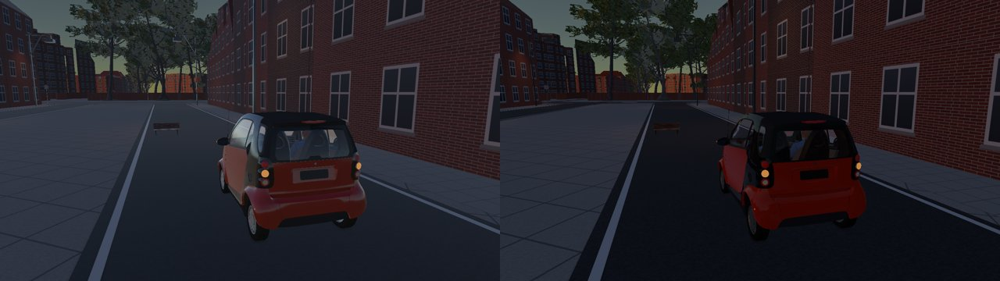

They can be set per trial with the experiment parameters `time` (`17:30` or `17.5`), `weather`, `fog`, `rain`, `timeSpeed`, `dayOfYear`, `latitude`. The host sends the conditions to all clients. With `UseBakedLighting` on (the experiments of earlier studies), the scene keeps its baked lightmaps and sun and only the weather effects apply; with it off (Base and the new examples), the sun follows the time of day with realtime lighting.


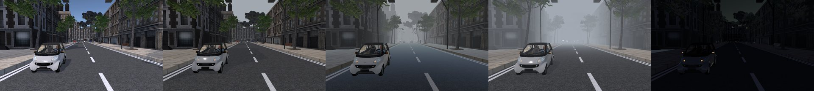

### Configuration of daylight conditions
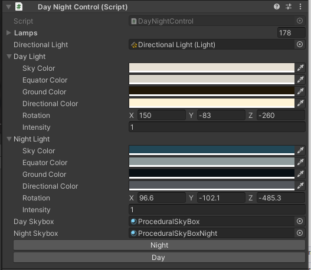

`DayNightControl` collects the lighting-related objects of a scene and holds two presets, Day and Night, to switch between while building an environment. When the environment is finished, save it as two scenes with different lighting and bake the lightmaps (as done for `MainScene` and `MainScene-night`). `LightProbePlacer` fills the map with a regular grid of light probes for baking (`Place Light Probes` button).

### Configuration of traffic lights
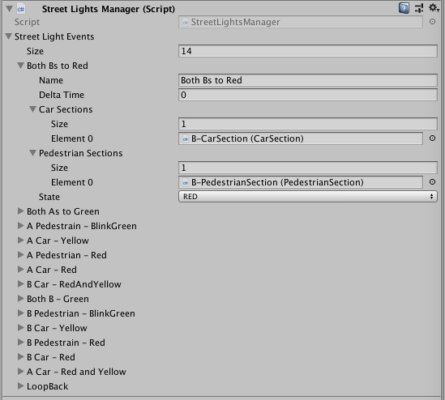

Start from an instance of the `ExampleStreetLightCrossSection` prefab. `TrafficLightsManager` controls `CarSection` and `PedestrianSection` objects, which group `CarTrafficLight` and `PedestrianTrafficLight`s that switch together.
- `initialStreetLightSetup`: list of `TrafficLightEvent`s applied once, before the simulation starts;
- `streetLightEvents`: list of `TrafficLightEvent`s that run one after another in a loop.

Each event has a `Name`, a `Delta Time` (seconds after the previous event), the `CarSections` and `PedestrianSections` it applies to, and the `State` to set. `CurrentIndex` and `CurrentTimer` let the loop start at a given event and time offset.

### Configuration of eHMIs
eHMIs are prefabs with a component derived from `HMI` that shows one of three states: `DISABLED`, `STOP` (do not cross) or `WALK` (you may cross). `AnimatorHMI` switches textures and animator triggers, `SpriteHMI` switches sprites; `StaticHMI` and `DynamicHMI` in `Assets/Prefabs/HMI` are examples. The AV passenger switches the state with `1`/`2`/`3`, the host with buttons in its GUI; `HMIManager` keeps all agents in sync.

### Auditory eHMIs
An `AuditoryEhmiSettings` component on the experiment prefab (child `Auditory eHMI` in the example experiments, off by default: tick `Enabled` or set the trial parameter `auditoryEhmi=1`) gives every AV in the experiment sounds, played from the front of the car (3D sound) on every agent:
- **cues**: a sound (`Chime`, `Beeps`, `Ding` or your own `AudioClip`) when the car's visual eHMI shows `STOP` or `WALK`, when it starts to brake, stops, drives off, when a pedestrian is ahead within a distance, or at a time; optionally repeated while the condition holds;
- **AVAS**: the acoustic vehicle alerting sound of electric cars (a hum that rises with speed and fades out at 20 km/h, as required in the EU).

Trial parameters `auditoryEhmi` (0/1) and `avas` (0/1) switch them per trial; `AllCars` gives the sounds to manually driven cars too. The cues played are logged to `ExperimentLogs/AuditoryEhmi-{date}.csv`.

### Details on editing car prefabs
The `Speedometer` component shows the speed:
- digital: set `Speedometer Text`;
- analog: set `Pivot` (pivot of the needle), `PivotMinSpeedAngle` and `PivotMaxSpeedAngle` (needle angle at 0 and at maximum speed) and `MaxSpeed`.

Other components on car prefabs: `CarConfigurator` (colour, driver and passenger visibility of AI cars), `SteeringWheel` (turns the steering wheel model), `RearMirrorsReflection` (mirror cameras), `CarBlinkers`, `DriverIKSetup` (driver's hands on the wheel) and the engine sound managers.

## Testing
`SmokeTest` runs a whole trial without a screen and checks that it works: it opens `StartScene`, starts a host that runs the first trial in keyboard mode, plays for the given time once the experiment runs, and writes a report with errors and exceptions, how far each car and pedestrian moved, and screenshots of the active cameras. It exits with code 0 when no errors occurred.

```
Unity -batchmode -projectPath . -executeMethod SmokeTest.Run -smokeSeconds 30 -smokeOut SmokeTest -logFile smoke.log
```

Options: `-smokeTrial N` (index in `Trials`), `-smokeExperiment N` and `-smokeRole N` (override the trial's experiment and role), `-smokeShot "x,y,z,yaw,pitch;..."` (extra screenshots from these camera poses), `-smokeScene <path>` (scene to start from).

The models (pedestrians, traffic, two-wheelers, vehicles, maps, trial files) have edit-mode tests (`Assets/Tests/EditMode`, 66 tests): run them in `Window` ➡️ `General` ➡️ `Test Runner`, or with `Unity -batchmode -projectPath . -runTests -testPlatform EditMode -testResults results.xml`. On Windows, `Unity` is `"C:\Program Files\Unity\Hub\Editor\6000.6.9f1\Editor\Unity.exe"`; on macOS `/Applications/Unity/Hub/Editor/6000.6.9f1/Unity.app/Contents/MacOS/Unity`.

**Two agents.** A second editor on an instant copy of the project can be a client: on macOS `cp -cR coupled-sim coupled-sim-client` (APFS copies in seconds; delete its `Temp` folder), then run the host with `-clients 1` and the client with `SmokeTest.Run -connect 127.0.0.1`. The reports list what each agent saw.

**Retaking the README pictures.** `Tools/readme_screenshots.sh` (macOS, screen unlocked, about 10 minutes) opens the editor and walks through the windows and screens shown in [Getting started](#getting-started-step-by-step) (`Assets/Editor/ReadmeScreenshots.cs`), saving them to `ReadmeShots/raw`. The pictures in `ReadmeFiles/guide` are made from these (cropped, with numbered markers).

## Hardware
### Several monitors and mirrors
`Managers` ➡️ `DisplayViews` adds views on extra monitors (or on the main screen) for the participant of that agent:
- `LeftScreen` / `RightScreen`: the view continued to the left and right, for a panorama of three monitors side by side (`ScreenAngle` = the angle between them; 0 = seamless);
- `RearMirror`, `LeftMirror`, `RightMirror`: mirror views (shown mirrored); on display 1 they appear at the top of the main view;
- `Custom`: any offset and rotation from the participant's eyes.

Each view has a `Display` (1 = the main monitor, 2 = the second one, ...) and an optional field of view. In a build, the extra monitors are switched on when the participant's avatar appears; in the editor, show them with Game views set to Display 2, 3, ... The command-line option `-views "LeftScreen:2,RightScreen:3,RearMirror:1"` sets the views without the editor. In VR, views on other monitors are for the experimenter (for example a mirror view of what the participant sees behind).

### Head-mounted displays (VR)
The simulator uses **OpenXR**, so it works with the PC VR headsets whose runtime supports OpenXR (Windows):

| Headset | Runtime to install and run | Notes |
| --- | --- | --- |
| Meta Quest 2 / 3 / 3S / Pro, Rift, Rift S | Meta Quest Link app ("Meta Horizon Link"); Quest via Link cable or Air Link | set Meta Quest Link as the active OpenXR runtime (Settings ➡️ General) |
| Varjo Aero, VR-3, XR-3, XR-4 | Varjo Base | eye tracking: enable it in Varjo Base |
| HTC Vive, Vive Pro (Eye), Vive Pro 2, Cosmos | SteamVR (or VIVE Console) | set SteamVR as the OpenXR runtime (SteamVR ➡️ Settings ➡️ OpenXR) |
| Valve Index, Pimax, Bigscreen Beyond | SteamVR | as above |
| HP Reverb G2 and other WMR headsets | Mixed Reality Portal / OpenXR Tools for WMR, or SteamVR | Windows Mixed Reality was removed in Windows 11 24H2 |
| Pico 4 / Neo 3 | Pico Connect (streaming) with SteamVR | |

1. Install the headset's runtime, connect the headset and check that its own home environment works.
2. Make that runtime the **active OpenXR runtime** (there can be only one; installing SteamVR or Meta Quest Link may switch it).
3. Start the simulator and choose `HMD mode` (host GUI, dashboard, or trial `Input Mode` = `VR`; the Xsens suit uses `Suite`). VR starts when the participant's avatar is spawned, so flat-screen PCs need no VR software at all (`XRSession`).
4. Press `R` (pedestrian) to recenter the view, with the participant looking straight ahead.

If the console says `XR: no headset found`: the runtime is not running, the headset is asleep or disconnected, or another OpenXR runtime is active. A black or frozen view usually means the runtime lost the headset: restart the runtime first, then the simulator. VR runs on Windows only (there are no OpenXR runtimes for macOS).

**Eye tracking.** With headsets that offer eye gaze through OpenXR (`XR_EXT_eye_gaze_interaction`: Varjo, Meta Quest Pro, HTC Vive Pro Eye with VIVE Console, Pico 4 Pro, HP Reverb G2 Omnicept), the participant's gaze is logged to `ExperimentLogs/EyeGaze-{date}.csv`: time, gaze origin and direction in world coordinates, and the object looked at with its distance (`EyeGazeLogger`). Turn eye tracking on in the headset's software and calibrate it there first.

### Steering wheels, pedals and gamepads
Any wheel that Windows sees as a game controller works: Logitech G25 / G27 / G29 / G920 / G923, Thrustmaster T150 / T248 / T300 / TX / T-GT, Fanatec CSL DD / ClubSport / Podium, Moza, and gamepads.
1. Install the wheel's driver software (Logitech G HUB, Thrustmaster drivers, Fanatec driver, Moza Pit House) and connect the wheel **before** starting the simulator (it detects wheels every few seconds, but some drivers only show up at start).
2. In the driver software, set the rotation range: 900° is realistic for cars, 450-540° is easier for unexperienced participants. Turn off "combined pedals" (Logitech) so throttle and brake are separate axes.
3. The simulator picks a profile by the wheel's name (`WheelProfile`; the G27 layout is the default for unknown wheels). **Calibrate** once per PC: press `F2` in the simulator, turn the wheel fully left and right, press each pedal fully and release it, press the buttons for gear forward/reverse and the blinkers, and save. The calibration window also shows the live axes and buttons, to check a wheel. The profile is saved in the simulator's data folder (`%USERPROFILE%\AppData\LocalLow\<company>\<product>\wheel-profile.json` on Windows).

The car (and the bicycle, e-scooter and moped) then reads steering, throttle and brake from the wheel, combined with the keyboard.

**Force feedback** (Logitech wheels): download the *Steering Wheel SDK* from Logitech's developer site and copy `LogitechSteeringWheelEnginesWrapper.dll` (64-bit) to `Assets/Plugins/x86_64` (it is not included in this repository because of its license). The simulator then adds a self-centring force that gets firmer with speed, damping, and a jolt in collisions (`SteeringFeedback`); without the DLL, the wheel uses its driver's own centring spring. Other brands: use the driver software's centring/spring settings.

**Gamepads** (Xbox, PlayStation): calibrate them like a wheel (`F2`): the left stick steers and the triggers act as pedals.

### Xsens MVN motion suit
1. Connect the suit's router to the PC (Ethernet in a yellow port) and plug the MVN dongle into a USB 3.0 port. Start MVN Analyze and create a recording with the participant's body measurements.
2. In `Options` ➡️ `Preferences` ➡️ `Miscellaneous` ➡️ `Network Streamer`, stream to this PC on **UDP port 9763** (the port `XsStreamReader` listens on) with the default pose datagrams (the old `Unity3D` datagram is not supported). If the avatar is jittery, raise the down-sampling skip factor.
3. Turn on the body pack (one beep), wait 30 s, press WPS on the router; when the body pack beeps again, hold its button for 2 s until it beeps twice and the light blinks. If it does not connect within a few minutes, reinstall MVN Analyze including the Bonjour print services.

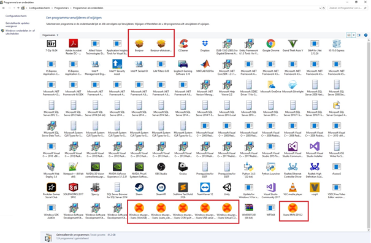

4. When the avatar moves in MVN Analyze, start the simulator in `Suite mode` (pedestrian roles; the prefabs are in `Assets/Prefabs/Xsens`). Align the HMD with the avatar's head with `R`, repeated until the participant confirms, for every trial. With a headset, the avatar's head turns with the headset's tracking instead of the suit's head sensor, so the two do not fight (`XsLiveAnimator` ➡️ `Head From Headset`).

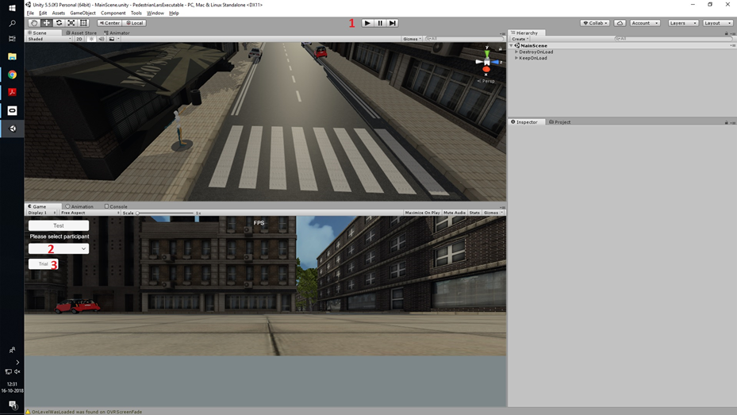

### Network
All agents must be in the same local network; the host's IP address is in its console. Allow these ports through the firewall of each PC (on Windows: inbound rules for the Unity editor of the version you use, and for the built simulator):

| Port | Protocol | Used for |
| --- | --- | --- |
| 7770 | UDP | agents (host and clients) |
| 8080 | TCP | experimenter dashboard (host) |
| 40131 | UDP, localhost | live data for external tools |
| 9763 | UDP | Xsens MVN stream |
| 8813 | TCP, localhost | SUMO (TraCI) |

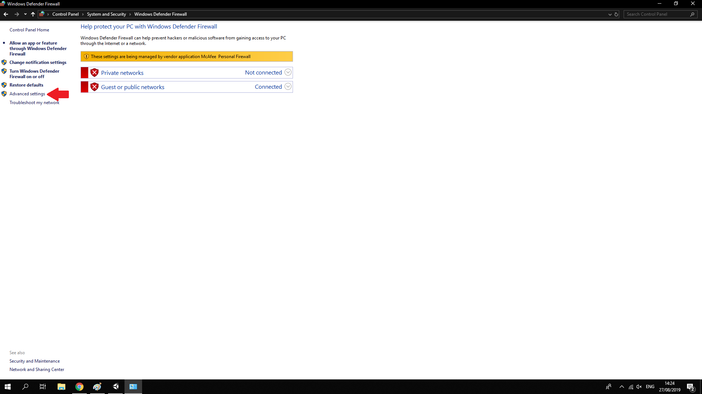

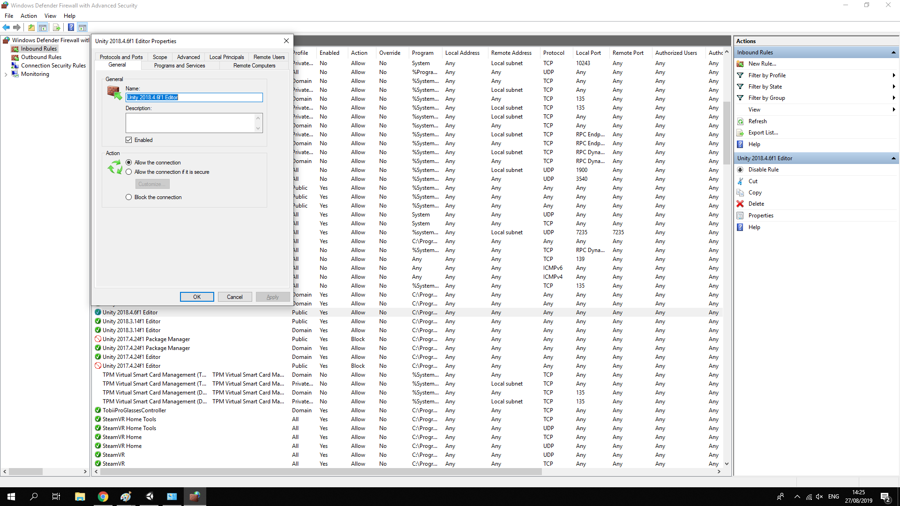

## FAQ
**Which Unity version do I need?** Unity 6.6 (6000.6.9f1). Newer 6.x versions will probably open the project but are not tested; older versions cannot open it. Versions of the simulator for Unity 2022.3 are in the git history.

**Which computer do I need?** Windows 10/11 with a recent GPU: a GeForce RTX 3060 or better for screens, RTX 3070/4070 or better for VR at 90 Hz, 16 GB of RAM. The editor also runs on macOS (no VR, no force feedback). One PC per participant; several agents on one PC are for testing only.

**How many participants can take part?** Four (host and three clients). The limit is `UNetConfig.MaxPlayers`; raising it works in principle but is not tested.

**Do I need SUMO?** Only for SUMO traffic (`SumoTraffic`, city maps). Install SUMO 1.20 or newer and set `SUMO_HOME`. Without it, the hand-built town has the built-in traffic models (`Traffic`) and city maps run without traffic.

**How do I make a new experiment?** `Coupled Sim` ➡️ `Experiments` ➡️ `Setup…` copies a template (`Base` for the town, `CityMap` for city maps) with the map, roles, traffic and conditions you choose and registers it (see [Setting up a new experiment](#setting-up-a-new-experiment)); then change it in prefab mode (spawn points, paths, pedestrians). The examples `PedestrianCrossings`, `Traffic`, `SumoTraffic` and `CityMap` show the newer features.

**Where are the data?** In `ExperimentLogs` next to the `Assets` folder (in builds: next to the executable): binary logs of all agents per frame and at 50 Hz, pedestrian decisions and eye gaze as CSV. Convert the binary logs to CSV in the start screen (`Convert log to csv`). See [Data logging](#data-logging).

**How do I keep videos and logs in sync?** Use `Visual syncing` (host GUI or dashboard): a red bar on every screen for 1 s, visible in screen recordings, logged as an event.

**How do I set weather, time of day and the city per trial?** With trial parameters, e.g. `time=21:30`, `weather=HeavyRain`, `map=Tokyo` or `location=52.0116,4.3571,400`; or in the dashboard.

**How do I add a city?** Use `location=lat,lon[,radius]` for any place, or add it to the catalogue (see [City maps](#city-maps-openstreetmap)).

**Some objects are pink.** A material uses a shader of the old Built-in render pipeline. Imported assets need converting to URP: `Window` ➡️ `Rendering` ➡️ `Render Pipeline Converter`, or `GraphicsSetup.ConvertToUrp` (see [Graphics](#graphics)).

**The headset is not found / shows black.** See [Head-mounted displays](#head-mounted-displays-vr): the right OpenXR runtime must be active and running before the simulator starts.

**The wheel does nothing, or the pedals are swapped.** Press `F2`: if the wheel is not listed, check the USB connection and its driver; if axes are wrong, run the calibration.

**The frame rate is low.** Start with `-quality Balanced` or `-quality Performance` (see [Graphics](#graphics)): shadows cost most. Run a build rather than the editor; in the editor, close the Scene view and use `Play Maximized`; reduce `EnvironmentController` ➡️ `MaxActiveStreetLights` at night; use a smaller city map or radius. On laptops, make sure the simulator runs on the dedicated GPU (NVIDIA Control Panel ➡️ Manage 3D settings). In VR, the headset's refresh rate (72-90 Hz) is the target.

**Cars drive on the left in London, but the car is left-hand drive.** Yes: maps with left-hand traffic place participants and SUMO traffic on the left, but there is no right-hand drive car model yet.

**Can I use my own avatars or cars?** Pedestrians: any humanoid character; `Coupled Sim` ➡️ `Pedestrians` ➡️ `Build pedestrian prefabs` makes AI pedestrians from Rocketbox-style models. Cars: copy a drivable car prefab and replace the model; AI cars need to be in `NetworkingManager` ➡️ `AI Car System` ➡️ `Prefabs`.

**Is there a way to test the simulator without screens and people?** Yes: the smoke test and the edit-mode tests (see [Testing](#testing)).

## Used assets
| Name | Developer | License |
| --- | --- | --- |
| [ACP (Arcade Car Physics)](https://github.com/Saarg/Arcade_Car_Physics) | Saarg | MIT |
| [Textures](https://ambientcg.com) (formerly cc0textures.com) | Various | CC0 |
| [PBR Bark Materials #1](https://assetstore.unity.com/packages/2d/textures-materials/pbr-bark-materials-1-86713) | John's Junkyard | Unity Asset Store EULA |
| Stylized Grass Texture | LowlyPoly | Unity Asset Store EULA |
| Suit Pack (participant avatar) | StudioNewPunch | Unity Asset Store EULA |
| Distance Tool (editor measuring tool) | Wes McDermott | Unity Asset Store EULA |
| Traffic light model | TurboSquid artist | TurboSquid Standard License |
| Claudia and Eric (pedestrian models) | Renderpeople | Renderpeople free license |
| [X Bot](https://www.mixamo.com) idle and walking animations | Adobe Mixamo | Mixamo terms |
| [Simple modular street kit](https://assetstore.unity.com/packages/3d/environments/urban/simple-modular-street-kit-13811) | Jacek Jankowski | Unity Asset Store EULA |
| [Realistic Tree 10](https://assetstore.unity.com/packages/3d/vegetation/trees/realistic-tree-10-54724) | Rakshi Games | Unity Asset Store EULA |
| [Small Town America - Streets](https://assetstore.unity.com/packages/3d/small-town-america-streets-free-59759) | MultiFlagStudios | Unity Asset Store EULA |
| Cars Free - Muscle Car Pack (no longer on the Asset Store) | Super Icon LTD | Unity Asset Store EULA |
| [Mini Cargo Truck](https://assetstore.unity.com/packages/3d/vehicles/land/mini-cargo-truck-68663) | Marcobian Games | Unity Asset Store EULA |
| [Street Bench](https://assetstore.unity.com/packages/3d/props/exterior/street-bench-656) | Rakshi Games | Unity Asset Store EULA |
| [Waste bin](https://assetstore.unity.com/packages/3d/waste-bin-73303) | Lowpoly_Master | Unity Asset Store EULA |
| [Smart fortwo](https://grabcad.com/library/smart-fortwo-1) | Filippo Citati | MIT |
| [Vehicle - Essentials](https://assetstore.unity.com/packages/audio/sound-fx/transportation/vehicle-essentials-194951) | Nox Sound | Unity Asset Store EULA |
| [Road System](https://assetstore.unity.com/packages/tools/level-design/road-system-192818) | Maxi Barmetler | Unity Asset Store EULA |
| [Kajaman's Roads](https://assetstore.unity.com/packages/3d/environments/roadways/kajaman-s-roads-free-52628) | Kajaman | Unity Asset Store EULA |
| [Animated animals](https://quaternius.com) (pigeon, Shiba Inu, husky, cat, fox, deer, horse; via [Poly Pizza](https://poly.pizza)) | Quaternius | CC0 |
| [Microsoft Rocketbox avatars](https://github.com/microsoft/Microsoft-Rocketbox) (12 avatars, textures reduced to 1024 px) | Microsoft | MIT |
| [HD Low Poly Racing Car No.1201](https://assetstore.unity.com/packages/3d/vehicles/land/hd-low-poly-racing-car-no-1201-118603) | Azerilo | Unity Asset Store EULA (free at time of download) |
