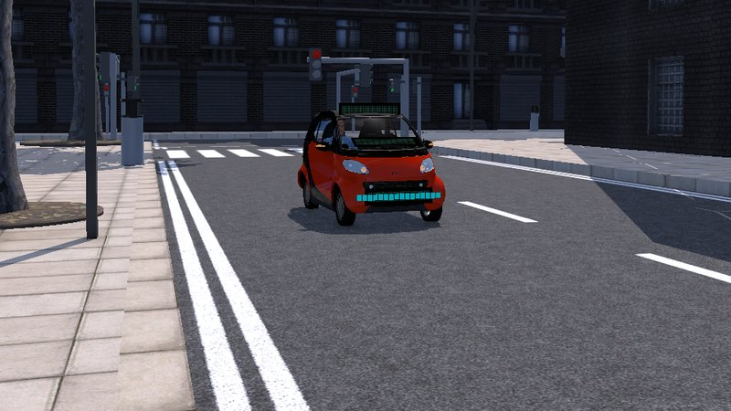

# Your first study with the coupled simulator

This tutorial takes you through a small but complete study, from the question to the data, **without opening Unity**: you use the ready-made simulator from the [Releases page](https://github.com/bazilinskyy/coupled-sim/releases). It is meant for students (for example in industrial design) who want to test an idea with real participants. It takes about an hour the first time.

**The question.** *Does a light on an automated car help pedestrians decide when to cross in front of it?* Two people take part at the same time: the experimenter sits in the automated car (AV) and the participant is a pedestrian at a crossing. In some trials the AV has no external display (eHMI), in some a cyan light bar on its bumper, in some a text "WALK" on its windscreen. The pedestrian holds a key while they feel safe to cross; the simulator logs that, and where everyone is, every frame.



## 1. Get the simulator
1. Download the zip for your computer (Windows or macOS) from the newest release on the [Releases page](https://github.com/bazilinskyy/coupled-sim/releases) and unzip it. On macOS, right-click `Coupled Simulator.app` and choose **Open** the first time (it is not signed).
2. Start it once to check it runs: you see the start screen with **Start host** and **Start client**. Close it again.

You need two computers on the same network (a lab or a home network), or one computer with two copies of the simulator open for trying things out. A laptop is fine: start the simulator with `-quality auto` (see step 4) and it picks a quality level that runs smoothly.

## 2. The trial file
A **trial file** says what happens in each trial. The release contains the one for this study, `first-study.csv` (in the folder `Coupled Simulator_Data/StreamingAssets/Trials` on Windows, or inside the app on macOS: right-click it, **Show Package Contents**, `Contents/Resources/Data/StreamingAssets/Trials`). Open it in Excel or a text editor:

```csv
#order=latin
experiment,role,block,clientRoles,ehmiDesign,weather,time,notes
base,Automated - Passenger,,Pedestrian,none,PartlyCloudy,13:00,practice
base,Automated - Passenger,A,Pedestrian,none,PartlyCloudy,13:00,no eHMI
base,Automated - Passenger,A,Pedestrian,none,PartlyCloudy,13:00,no eHMI
base,Automated - Passenger,B,Pedestrian,LightBarCyan@Bumper,PartlyCloudy,13:00,light bar
...
```

- Each row is a trial: the experiment (`base`: a small town), the host's role (the AV's passenger), the client's role (`clientRoles`: the pedestrian) and the conditions.
- `ehmiDesign` is the AV's eHMI in that trial: one of the designs in `StreamingAssets/eHMI` (`LightBarCyan`, `TextWalk`, `DirectionalChevrons`, `RoadProjection`, or your own, see step 7) and where it sits (`@Bumper`, `@Hood`, `@Top`, `@Windshield` or `@Road`); `none` for no eHMI.
- `block`: the rows with the same letter stay together, and `#order=latin` changes the order of the blocks per participant (a balanced Latin square), so that learning and tiredness do not favour one eHMI. The first row (no block) is a practice trial and always comes first.
- Change the conditions as you like: `weather` (`Clear`, `Overcast`, `LightRain`, `HeavyRain`, `Fog`, `LightSnow`, ...), `time` (`17:30`), `rain`, `fog`, or a real city with `map=Delft` (and an experiment and roles that exist there, see the README's city maps).

## 3. The participant's task
The pedestrian answers with a **hold-to-respond button**: hold `B` (or the right trigger of a gamepad) while you feel safe to cross. Tell the participant before the practice trial: "You are a pedestrian waiting at the kerb. An automated car will come. Hold B whenever you would feel safe to cross the road in front of it, and release it when you would not." You can also give them a slider (0-100, keys `Z` and `X`) for, for example, trust, with `-response button,slider`.

## 4. Run a session
On the **experimenter's** computer (the host), open a terminal (Windows: in the unzipped folder, type `cmd` in the address bar) and start:

```
"Coupled Simulator.exe" -trials first-study.csv -participant 1 -autoRun -clients 1 -quality auto
```

(macOS: `"Coupled Simulator.app/Contents/MacOS/Coupled Simulator" -trials first-study.csv -participant 1 -autoRun -clients 1 -quality auto`.) It waits for one client. Find the host computer's address on the network (Windows: `ipconfig` in the terminal, the IPv4 address; macOS: System Settings, Network), for example `192.168.1.20`, and allow the simulator through its firewall when asked.

On the **participant's** computer (the client):

```
"Coupled Simulator.exe" -connect 192.168.1.20 -response button -quality auto
```

The first trial starts by itself when both are ready. As the AV's passenger, you switch the eHMI's state with the keys `1` (off), `2` (stop) and `3` (walk), for example to **walk** when the car has stopped for the pedestrian; in trials without an eHMI the keys do nothing. `Esc` ends a trial and starts the next; after the last trial the simulator stops.

For the next participant use `-participant 2`, and so on: each gets their own order of the eHMI blocks.

**From a tablet or another computer.** While the host runs, open `http://<host address>:8080` in a browser on the same network: the [experimenter dashboard](../README.md#experimenter-dashboard) shows a live map of the scene with both participants, who is connected and ready, and lets you go to the next trial, switch the eHMIs or change the weather.

## 5. Your data
Everything is in the `ExperimentLogs` folder next to the simulator (on macOS in the folder you started it from):

| File | What is in it |
|---|---|
| `Session-P01-....csv` | the order of the trials this participant got: trial number, experiment, role and the conditions (`parameters`, as `name=value;...`) |
| `Responses-P01-T03-Pedestrian-....csv` | (on the client) every frame of trial 3, separated by `;`: UTC time, game time, frame, button held (0/1), its analog value, presses, slider |
| `HostLog-P01-T03-....binLog` | where every car, pedestrian and traffic light was, every frame (convert it to CSV, step 6) |
| `HostLog-P01-T03-....replay.json` | what is needed to watch the trial again (`-replay` the `.binLog`) |

Copy the client's `Responses-*` files to the host's folder after the session.

## 6. Analyse
Convert a trial's log to CSV: start the simulator without options, click **Convert log to csv** on the start screen (before starting a host) and choose the log and a reference point. Then, for example in Python, compare how long pedestrians felt safe in each condition:

```python
import glob, pandas as pd

rows = []
for session in glob.glob("ExperimentLogs/Session-P*.csv"):
    order = pd.read_csv(session)                      # one row per trial
    p = session.split("Session-")[1].split("-")[0]    # "P01"
    for _, trial in order.iterrows():
        conditions = dict(x.split("=", 1) for x in str(trial["parameters"]).split(";") if "=" in x)
        files = glob.glob(f"ExperimentLogs/Responses-{p}-T{int(trial['trial']):02d}-*.csv")
        if not files: continue
        r = pd.read_csv(files[0], sep=";")
        rows.append({"participant": p, "eHMI": conditions.get("ehmiDesign"), "safe": r["button"].mean()})

data = pd.DataFrame(rows)
print(data.groupby("eHMI")["safe"].describe())       # share of the trial in which they felt safe
```

Watch a trial again to see what happened: `"Coupled Simulator.exe" -replay "ExperimentLogs/HostLog-P01-T03-....binLog"` (keys: `Space` pause, arrows to skip, `1`-`9` to follow a participant).

## 7. Make it yours
- **Your own eHMI**: copy `StreamingAssets/eHMI/LightBarCyan.json`, give it a new name and change the colours, the shapes (`lightbar`, `rect`, `circle`, `arrow`, `chevrons`, `text`) and what it shows in each state; use its name in `ehmiDesign`. No Unity needed. The README's [designed eHMIs](../README.md#designed-ehmis) lists everything you can set.
- **Other conditions** per trial: time of day, weather, the AV's speed (`avSpeed`), sounds of the AV (`auditoryEhmi=1`), animals (`animals=3`).
- **Other places and roles**: a real city (`map=Delft`), the pedestrian as a cyclist, several pedestrians at once (up to 8 participants). For new experiments (spawn points, routes) you need Unity: follow [Getting started, step by step](getting-started.md#9-making-your-own-experiment), step 9, which uses a setup window rather than code.

**Before your real study**: run a pilot with two or three people, check that the files contain what you need, and ask your ethics committee for approval (simulators can cause motion sickness in some people: let participants stop at any time).
