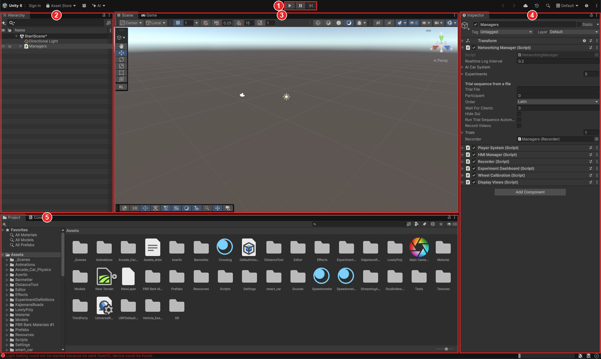
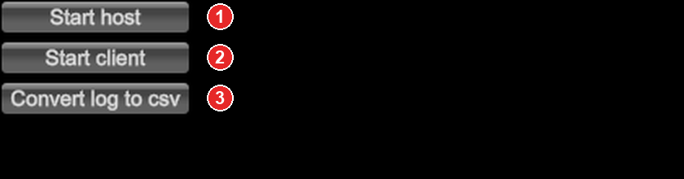
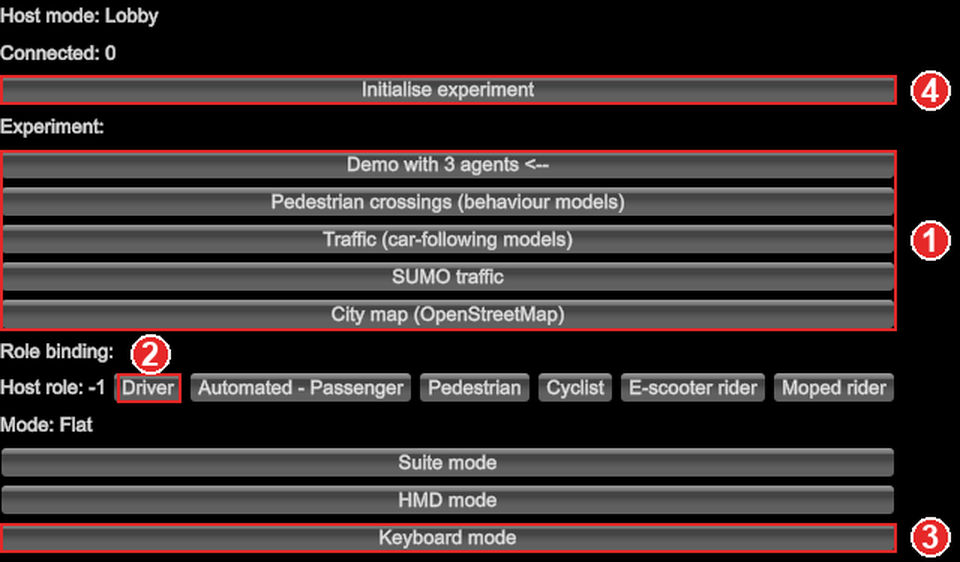
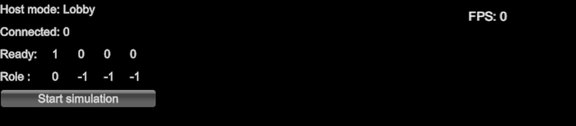
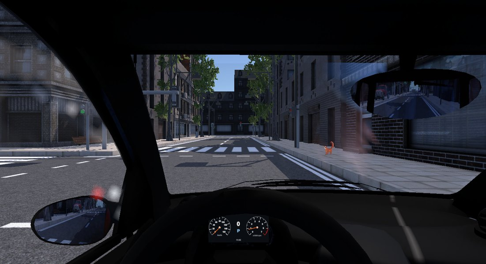
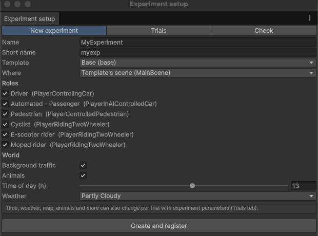
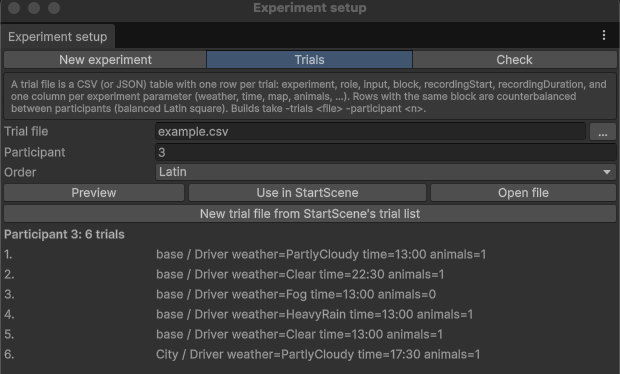
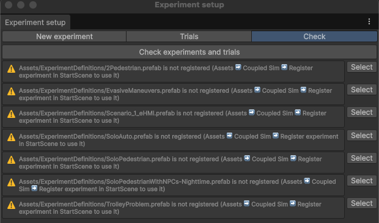
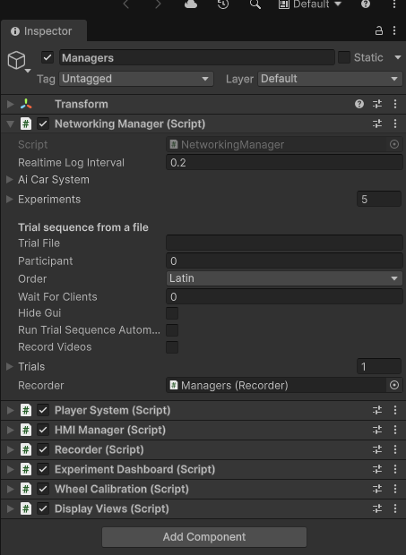
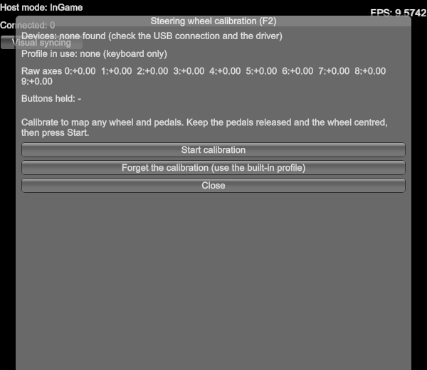

# Getting started, step by step

Back to the [README](../README.md). For the ready-made simulator without Unity, see [Your first study](first-study.md) instead.

This guide is for anyone who has never used Unity or GitHub. Follow the steps in order; each takes a few minutes, except the first opening of the project (step 4), which takes up to an hour. Words in **bold** are the names of buttons or windows you will see on the screen.

## Words you will meet
| Word | What it means here |
| --- | --- |
| **Unity** | The program the simulator is made with. You open the simulator in it, like you open a document in Word. |
| **Unity Hub** | A small program that installs Unity and opens Unity projects. |
| **Project** | The simulator's folder. Unity calls a folder like this a project. |
| **Scene** | One "world" of the simulator: the start screen (`StartScene`), the town (`MainScene`), a city map (`OsmMap`). |
| **Play / Play mode** | The ▶ button at the top of Unity starts the simulator inside Unity; pressing it again stops it. |
| **Host** and **client** | Every computer taking part is an *agent*. One of them is the **host**: it chooses the experiment and starts it. The others are **clients**: they connect to the host. Alone, you are the host. |
| **Role** | Who a participant is in the scene: driver, passenger of an automated car (AV), pedestrian, cyclist, race cyclist, e-scooter or moped rider. |
| **Experiment** | A ready-made situation: a world, the roles in it, the AI cars and pedestrians, the weather. |
| **Trial** | One run of an experiment with one participant. A session is usually several trials. |
| **Inspector** | The window on the right of Unity that shows the settings of whatever you clicked. |
| **Prefab** | A saved, reusable object (a car, a pedestrian, a whole experiment). Changing the prefab changes every copy of it. |
| **Spawn point** | The place where a participant starts in the world. |

**New to it? Start with the tutorial [Your first study](first-study.md)**: a complete small study (an eHMI on an automated car and a pedestrian, two participants, counterbalanced trials, responses and logs, a short analysis) with the ready-made simulator from the [Releases page](https://github.com/bazilinskyy/coupled-sim/releases), without Unity. The steps below set up Unity, which you need to make new experiments.

## 1. What you need
- A computer with **Windows 10 or 11** (or a Mac, for trying things out: steering wheels, headsets and the motion suit only work on Windows).
- About **30 GB of free disk space** (Unity takes about 10 GB, the simulator about 15 GB once opened).
- An internet connection and a free **Unity account** (make one at [unity.com](https://unity.com) with your university e-mail; the free "Personal" license is enough).
- For a good frame rate: a graphics card such as an NVIDIA GeForce RTX 3060 or better. On a laptop or office PC the simulator also runs, but slower (see [Graphics](../README.md#graphics) for the faster quality levels).

## 2. Install Unity Hub and Unity
1. Download **Unity Hub** from [unity.com/download](https://unity.com/download) and install it like any other program.
2. Open Unity Hub and **Sign in** with your Unity account. If it asks for a license, choose the free **Personal** license.
3. You do not have to install Unity itself yet: in step 4, Unity Hub notices which version the simulator needs (**6000.6.9f1**, also called Unity 6.6) and offers to install it. When it asks which **modules** to add, you need none to use the simulator inside Unity. Tick **Windows Build Support (Mono)** only if you want to make a stand-alone program for the lab PCs from a Mac (on Windows it is included); you do not need IL2CPP, Android, iOS or WebGL. Windows may ask for administrator permission while installing: that is normal.

Use exactly version 6000.6.9f1. A newer Unity may change or break the project; an older one cannot open it.

## 3. Download the simulator
The easiest way, without typing commands:
1. Install **GitHub Desktop** from [desktop.github.com](https://desktop.github.com) (you can skip signing in to GitHub).
2. In GitHub Desktop choose **File** ➡️ **Clone repository** ➡️ the **URL** tab, and paste `https://github.com/bazilinskyy/coupled-sim`.
3. Under **Local path** choose a short folder path **without spaces**, for example `C:\Unity\coupled-sim` (long paths cause errors on Windows). Press **Clone** and wait until it finishes (about 0.7 GB).

Later, to get the newest version, open GitHub Desktop and press **Fetch origin** and then **Pull origin**. If GitHub Desktop says you have local changes (Unity changes a few files by itself), choose **Stash changes and continue**; your own experiments are best kept in new files (step 9), so nothing of yours is lost.

(If you know git: `git clone https://github.com/bazilinskyy/coupled-sim.git` does the same. Downloading the ZIP file from GitHub also works, but then you cannot update it easily.)

## 4. Open the project in Unity
1. In Unity Hub, go to **Projects** and press **Add** ➡️ **Add project from disk**. Select the `coupled-sim` folder you just downloaded (the folder that contains `Assets`), and confirm.
2. The project appears in the list. If Unity Hub shows a warning that the editor version is missing, press **Install** (this is the step-2 install of Unity 6000.6.9f1; it takes 10-30 minutes).
3. Click the project to open it. **The first time takes long** (20-60 minutes): Unity prepares all the files. A small window shows "Importing" or "Compiling" with a progress bar that sometimes stands still for minutes; that is normal, do not close Unity. Wait until the Unity window appears and the progress bar at the bottom right is gone.
4. If Unity asks whether to open in **Safe Mode**, choose **Ignore** (this happens when something did not finish preparing; see [When something goes wrong](#11-when-something-goes-wrong)).

## 5. The Unity window

1. **Play** ▶: starts and stops the simulator. While it runs, the button is blue.
2. **Hierarchy**: what is in the open scene. In `StartScene` there is an object called `Managers` that holds the simulator's settings.
3. **Scene** and **Game**: the **Game** tab shows what a participant sees when you press Play.
4. **Inspector**: the settings of what you clicked (here `Managers`).
5. **Project** and **Console**: the **Project** tab shows the files of the simulator; the **Console** tab shows messages. Red messages are errors (one red line about "light baking" or "OpenCL" can be ignored).

The **Coupled Sim** menu (in the menu bar at the very top of the screen on a Mac, or at the top of the Unity window on Windows) has the simulator's own tools: setting up experiments, checking them, building, and more.

**Open the start scene first.** In the **Project** tab open the folder `Assets` ➡️ `_Scenes` and double-click **StartScene**. The **Hierarchy** then shows `StartScene` with `Managers` in it. The simulator always starts from this scene: if another scene of the simulator (the town, a city map) is open when you press **Play**, Unity starts from `StartScene` anyway, but the settings you change in the **Inspector** (step 10) are those of `StartScene`, so keep it open.

**Closing Unity:** **File** ➡️ **Quit** (on a Mac **Unity** ➡️ **Quit**). If Unity asks whether to save changes to a scene you did not mean to change, choose **Don't Save**.

## 6. Your first drive (alone, on one computer)
1. Press **Play** ▶. The **Game** tab shows three buttons:

   

   **1** Start host (you run the experiment), **2** Start client (you join someone else's experiment), **3** Convert log to csv (turn recorded data into a spreadsheet file, see step 7).
2. Press **Start host**. You now see the host's choices:

   

   1. **Experiment**: click the experiment. **Demo with 3 agents** is a good first one (the arrow `<--` shows which one is selected).
   2. **Role binding**: click the role you want to play, for example **Driver**. "Host role" then shows the role's number instead of -1 (the roles are counted from 0, so Driver, the first one, is 0).
   3. **Mode**: click **Keyboard mode** to play on the screen with keyboard and mouse (**HMD mode** is for a VR headset, **Suite mode** for the Xsens motion suit).
   4. Press **Initialise experiment** (the top button in the picture).
3. Wait until the world has loaded (up to a minute). The screen then shows who is ready and a **Start simulation** button:

   

   **Ready: 1** means your computer is ready; the other columns are for other computers (clients) and stay 0 when no client is connected, which is fine. Press **Start simulation**.
4. Drive! First **click once in the Game view**, so the keys go to the simulator:

   

   - `W` / `S` (or the arrow keys): accelerate / brake; `A` / `D`: steer; `Space`: brake; `R` then `W`: reverse (only when the car stands still); `F`: forward again; `Q` / `E`: blinkers; `Esc`: end the drive.
   - As a pedestrian: `W` `A` `S` `D` to walk, `Shift` to run, hold the right mouse button and move the mouse to look around.
   - All keys are listed under [Controls](../README.md#controls). The buttons and numbers in the corner are for the experimenter: **Visual syncing** flashes the screen to line up video recordings with the data, and the frame rate (FPS) shows how smoothly the simulator runs (60 or more is good). `Tab` hides them; press `Tab` again to show them.
5. To stop, press **Play** ▶ again. Everything you changed while playing is undone; the data that was recorded stays (step 7).

## 7. Where your data are
Every run writes its data into the folder **`ExperimentLogs`** inside the `coupled-sim` folder, next to the `Assets` folder. To open it from Unity: in the **Project** tab right-click the `Assets` folder and choose **Show in Explorer** (Windows) or **Reveal in Finder** (Mac); this opens the `coupled-sim` folder, where you see `ExperimentLogs`. The folder only appears after your first run. The files are named after the role and the date and time, for example `HostLog-Driver-2026_11_13_14_05_22.binLog`; some experiments write extra `.csv` files next to it.

`.binLog` files are compact but cannot be opened in Excel. To turn one into a spreadsheet file:
1. Press **Play**, and on the start screen press **Convert log to csv** (3).
2. Click the file you want (the newest is at the top). Ignore **Custom reference points** (they are for measuring from a chosen point, such as a crossing) and, under **Stored reference Point**, press **Transform with World Root**.
3. A line "Saved ..." shows where the new file `World Root-HostLog-....csv` is (in `ExperimentLogs`). Open it in Excel, R or Python.

In Excel, open it with **Data** ➡️ **From Text/CSV** and choose **Semicolon** as the delimiter. The numbers use a decimal point; if Excel shows them as dates or text (computers set to Dutch or German use a decimal comma), choose **Transform Data**, then **Use Locale** "English (United States)" for the number columns.

To watch a run again, press **Replay a recording** on the start screen instead (see [Data logging](../README.md#data-logging)).

What is in these files, and the other files there (pedestrian decisions, eye gaze, take-over times, animals), is described under [Data logging](../README.md#data-logging).

## 8. With several participants (several computers)
1. Install the simulator on every computer as above, **the same version on all** (in GitHub Desktop: Fetch and Pull on each).
2. Connect all computers to the same network (the same lab switch or Wi-Fi). The first time you press **Start host** or **Start client**, Windows asks whether to allow Unity on the network: tick **Private networks** (and **Domain networks** on university PCs) and press **Allow access**. See [Network](../README.md#network) if the computers cannot find each other.
3. On the host computer: press **Play** and **Start host**. The **Console** shows a line `Listening on ...` with the host's address (four numbers with dots, for example `192.168.1.20` or `10.0.0.5`).
4. On each other computer: press **Play** and **Start client**. The address box already holds `192.168.1.11`: replace it with the host's address. The **Connect** button appears only when the address is complete (four numbers); press it, then choose the mode (for example **Keyboard mode**).
5. On the host, the clients appear ("Connected: 1", ...). Choose the experiment, give each participant a role under **Role binding** (one row per computer), press **Initialise experiment**, wait until every column under **Ready** shows 1, and press **Start simulation**.

The experimenter can also do all of this from a phone or tablet in the same network with the [dashboard](../README.md#experimenter-dashboard).

## 9. Making your own experiment
Open **Coupled Sim** ➡️ **Experiments** ➡️ **Setup…**. The window has three tabs.

**New experiment**: give it a name, pick a **Template** (start from **Base** for the town, or **CityMap** for a real city), choose **Where** it takes place (the town, one of 20 cities, or any place by coordinates), untick roles you do not need, choose traffic, animals, time of day and weather, and press **Create and register**. Then place the spawn points:
1. Press **Open it to place spawn points**. Unity opens the experiment's world with a copy of your experiment in it (for city maps, the experiment itself opens).
2. In the **Hierarchy**, unfold the experiment and click a spawn point; move it with the arrows in the **Scene** view.
3. When all are in place, click the experiment at the top of the **Hierarchy**, and in the **Inspector** choose **Overrides** ➡️ **Apply All**. This saves the positions into the experiment.
4. Delete the copy from the **Hierarchy** (right-click ➡️ **Delete**), save the scene (`Ctrl+S`, on a Mac `Cmd+S`), and open **StartScene** again (step 5).

**Trials**: plan a session in a spreadsheet instead of clicking through it (step 10). Choose a trial file and a participant number and press **Preview** to see that participant's order:

**Check**: press **Check experiments and trials** to find mistakes before you run anything. Errors (red) must be fixed; warnings (yellow), such as older experiments that are not registered, can be ignored. The same check runs every time you press Play.

More detail: [Setting up a new experiment](../README.md#setting-up-a-new-experiment).

## 10. Running a whole session automatically
For a real study you usually want each participant to get a fixed list of trials, in a counterbalanced order, without clicking:
1. Make a trial file: in the **Project** tab open `Assets/StreamingAssets/Trials`, click `example.csv`, press `Ctrl+D` (Mac `Cmd+D`) to copy it, and give the copy a new name. Open it in Excel (or double-click it in Unity). Each row is one trial: the experiment, the role, the conditions (weather, time, ...), and a `block` letter for the conditions whose order should change between participants. Keep the lines that start with `#` (they hold settings). Save it as CSV.
2. **With Play off**, click `Managers` in the **Hierarchy**. In the **Inspector**, under **Networking Manager**: type the file name in **Trial File** (or press **Use in StartScene** in the **Trials** tab of step 9), the participant's number in **Participant**, and tick **Run Trial Sequence Automatically** (and **Hide Gui**, so the participant does not see the buttons). Save the scene (`Ctrl+S` / `Cmd+S`); changes made while playing are lost.

   

3. Press **Play**: the first trial starts by itself. **Esc** ends a trial and starts the next one; after the last trial the simulator stops.
4. For the next participant, change **Participant** (Play off) and save. To go back to choosing by hand (step 6), untick **Run Trial Sequence Automatically** and **Hide Gui**.

The log files of that session start with the participant and trial number (for example `HostLog-P03-T02-...`), and `ExperimentLogs/Session-P03-....csv` lists the order this participant got. Details: [Trial files and counterbalancing](../README.md#trial-files-and-counterbalancing).

## 11. When something goes wrong
| What you see | What to do |
| --- | --- |
| Unity Hub says the editor version is not installed | Press **Install** next to the project (step 4). Use 6000.6.9f1, not another version. |
| Unity asks about **Safe Mode** when opening | Choose **Ignore**. If red errors stay in the **Console**, close Unity, delete the `Library` folder inside `coupled-sim`, and open the project again (Unity rebuilds it). |
| Pressing **Play** shows a dialog **Experiment setup problems** | The check (step 9) found a mistake. Read it, fix it, or press **Play anyway** if you are only trying things out. |
| Pressing **Play** shows no buttons | Open **StartScene** (step 5). If it is open, press `Tab` (it hides and shows the buttons) and check that **Hide Gui** on `Managers` is unticked. |
| **Convert log to csv** shows no files | Nothing has been recorded yet: run an experiment first (step 6). |
| Nothing happens when you press keys | Click once inside the **Game** view first. |
| Parts of the world are **pink** | A material was not converted for the current graphics; see the [FAQ](../README.md#faq). |
| The simulator is very slow | Close other programs, or use a lower quality level (see [Graphics](../README.md#graphics)). In Unity, close the **Scene** tab while playing. |
| Clients cannot connect | Same network? Same simulator version? Firewall allowed? See [Network](../README.md#network). |
| The steering wheel does nothing | While playing, press `F2` to open the wheel calibration window and follow it: |

If you are stuck, ask in the lab or open an issue on GitHub with a screenshot of the **Console**.
